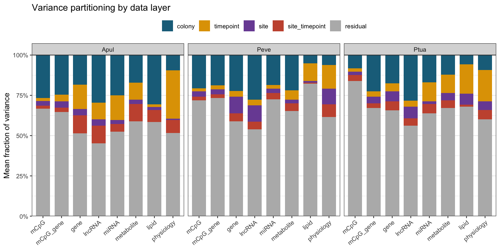
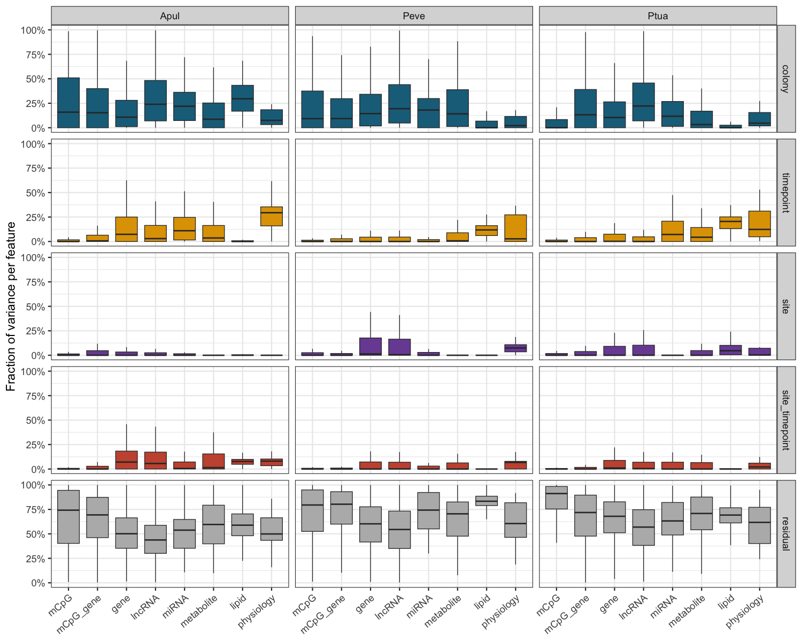

55-variance-partitioning
================
Steven Roberts
2026-11-23

- [1 Goal](#1-goal)
- [2 Sample metadata](#2-sample-metadata)
- [3 Load and transform each layer](#3-load-and-transform-each-layer)
  - [3.1 Count layers (genes, lncRNA,
    miRNA)](#31-count-layers-genes-lncrna-mirna)
  - [3.2 CpG methylation](#32-cpg-methylation)
  - [3.3 Gene-body methylation](#33-gene-body-methylation)
  - [3.4 Metabolites and lipids](#34-metabolites-and-lipids)
  - [3.5 Physiology](#35-physiology)
  - [3.6 What goes into the models](#36-what-goes-into-the-models)
- [4 Fit the variance components](#4-fit-the-variance-components)
- [5 Results](#5-results)
  - [5.1 Mean fraction of variance by
    layer](#51-mean-fraction-of-variance-by-layer)
  - [5.2 Distribution across features](#52-distribution-across-features)
  - [5.3 Gene-body methylation by methylation
    level](#53-gene-body-methylation-by-methylation-level)
  - [5.4 Physiology traits
    individually](#54-physiology-traits-individually)

# 1 Goal

For every data layer in every species, estimate how much of each
feature’s variance is attributable to

- **colony** - stable differences among colonies (genotype plus any
  fixed micro-habitat effect), nested within site
- **timepoint** - change shared by all colonies at both sites (season)
- **site** - stable difference between Manava and Mahana
- **site:timepoint** - change over time that differs between sites
  (local environment)
- **residual** - colony-specific change over time plus measurement noise

Model fitted to each feature, with all terms as random effects:

`y ~ (1 | colony) + (1 | timepoint) + (1 | site) + (1 | site:timepoint)`

Caveats to keep in mind when reading the results:

- Site has 2 levels and timepoint has 4, so those two variance
  components are estimated imprecisely for any single feature.
  Layer-wide means are far more trustworthy than per-feature values.
- The residual mixes real colony-specific plasticity with technical
  noise. These data have no technical replicates to separate them.
- The merged CpG matrices (`_filtered_n20`) keep CpGs called in at least
  20 samples. The per-CpG layer here uses only CpGs called in *every*
  sample of the species, a small and non-random subset of the genome.
- A single CpG’s percent methylation has large sampling error at typical
  WGBS depth, which inflates its residual. The gene-body layer
  (`mCpG_gene`) averages at least 10 CpGs per gene and sample to reduce
  that.

``` r
knitr::opts_chunk$set(echo = TRUE, message = FALSE, warning = FALSE,
                      fig.width = 10, fig.height = 6, dpi = 150)
library(data.table)
library(lme4)
library(DESeq2)
library(ggplot2)
library(parallel)

out_dir <- "../output/55-variance-partitioning"
dir.create(out_dir, showWarnings = FALSE, recursive = TRUE)
n_cores <- max(1, min(8, detectCores() - 2))
set.seed(55)
n_cpg_max <- 20000   # CpGs sampled per species for model fitting
```

# 2 Sample metadata

`master-molecular-metadata.csv` is the source of colony, timepoint and
site. Every layer’s column names are normalised to `XXX-###-TP#`.

``` r
meta <- fread("../../master-molecular-metadata.csv")
meta[, sample := paste(colony, timepoint, sep = "-")]
meta[, st := paste(site, timepoint, sep = ":")]
meta <- meta[, .(sample, colony, timepoint, site, st, species)]
setkey(meta, sample)
meta[, .N, by = .(species, site)]
```

    ##                     species   site     N
    ##                      <char> <char> <int>
    ## 1:         Acropora pulchra Manava    20
    ## 2:         Acropora pulchra Mahana    20
    ## 3: Pocillopora tuahiniensis Mahana    19
    ## 4: Pocillopora tuahiniensis Manava    20
    ## 5:        Porites evermanni Mahana    18
    ## 6:        Porites evermanni Manava    20

``` r
# Pull "ACR-139-TP1" out of any of the sample-name styles used in the repo
canon <- function(x) {
  m <- regmatches(x, regexpr("(ACR|POR|POC)-[0-9]+[-_]TP[1-4]", x))
  out <- rep(NA_character_, length(x))
  out[grepl("(ACR|POR|POC)-[0-9]+[-_]TP[1-4]", x)] <- sub("_", "-", m)
  out
}

# features x samples numeric matrix with canonical sample names;
# duplicated sample columns (technical replicates) are summed
as_matrix <- function(dt, id_col = 1, drop = NULL) {
  ids <- dt[[id_col]]
  keep <- setdiff(names(dt), c(names(dt)[id_col], drop))
  s <- canon(keep)
  keep <- keep[!is.na(s)]; s <- s[!is.na(s)]
  m <- as.matrix(dt[, ..keep]); storage.mode(m) <- "double"
  if (anyDuplicated(s)) m <- t(rowsum(t(m), s)) else colnames(m) <- s
  rownames(m) <- ids
  m[, sort(colnames(m)), drop = FALSE]
}
```

# 3 Load and transform each layer

``` r
sp <- list(
  Apul = list(prefix = "ACR",
    gene   = "../../D-Apul/output/02.20-D-Apul-RNAseq-alignment-HiSat2/apul-gene_count_matrix.csv",
    lncRNA = "../../D-Apul/output/31.5-Apul-lncRNA-discovery/lncRNA_counts.clean.filtered.txt",
    miRNA  = "../output/10-format-miRNA-counts/Apul_miRNA_counts_formatted.txt",
    mCpG   = "https://gannet.fish.washington.edu/metacarcinus/E5/20250903_meth_Apul/merged-WGBS-CpG-counts_filtered_n20.csv"),
  Peve = list(prefix = "POR",
    gene   = "../../E-Peve/output/02.20-E-Peve-RNAseq-alignment-HiSat2/peve-gene_count_matrix.csv",
    lncRNA = "../../E-Peve/output/12-Peve-lncRNA-discovery/lncRNA_counts.clean.filtered.txt",
    miRNA  = "../output/10-format-miRNA-counts/Peve_miRNA_counts_formatted.txt",
    mCpG   = "https://gannet.fish.washington.edu/metacarcinus/E5/Pevermanni/20250821_meth_Peve/merged-WGBS-CpG-counts_filtered_n20.csv"),
  Ptua = list(prefix = "POC",
    gene   = "../../F-Ptua/output/02.20-F-Ptua-RNAseq-alignment-HiSat2/ptua-gene_count_matrix.csv",
    lncRNA = "../../F-Ptua/output/06-Ptua-lncRNA-discovery/lncRNA_counts.clean.filtered.txt",
    miRNA  = "../output/10-format-miRNA-counts/Ptuh_miRNA_counts_formatted.txt",
    mCpG   = "https://gannet.fish.washington.edu/metacarcinus/E5/Ptuahiniensis/20250821_meth_Ptua/merged-WGBS-CpG-counts_filtered_n20.csv")
)
```

## 3.1 Count layers (genes, lncRNA, miRNA)

Features are kept if they have at least `min_count` reads in at least a
quarter of samples, then variance-stabilised with DESeq2.

``` r
dropped <- list()
vst_counts <- function(m, min_count = 10, label = "") {
  m <- round(m)
  # samples with almost no reads cannot be normalised; drop and record them
  low <- colSums(m) < 1000
  if (any(low)) {
    dropped[[label]] <<- data.table(layer = label, sample = colnames(m)[low],
                                    total_counts = colSums(m)[low])
    m <- m[, !low, drop = FALSE]
  }
  m <- m[rowSums(m >= min_count) >= ceiling(ncol(m) / 4), , drop = FALSE]
  dds <- DESeqDataSetFromMatrix(m, data.frame(row.names = colnames(m)), ~ 1)
  # "poscounts" tolerates layers (miRNA) where every feature has a zero somewhere
  dds <- estimateSizeFactors(dds, type = "poscounts")
  v <- tryCatch(varianceStabilizingTransformation(dds, blind = TRUE),
                error = function(e)
                  varianceStabilizingTransformation(dds, blind = TRUE, fitType = "mean"))
  assay(v)
}

layers <- list()
for (s in names(sp)) {
  layers[[s]] <- list(
    gene   = vst_counts(as_matrix(fread(sp[[s]]$gene)), label = paste(s, "gene")),
    lncRNA = vst_counts(as_matrix(fread(sp[[s]]$lncRNA),
                                  drop = c("Chr", "Start", "End", "Strand", "Length")),
                        label = paste(s, "lncRNA")),
    miRNA  = vst_counts(as_matrix(fread(sp[[s]]$miRNA)), min_count = 5,
                        label = paste(s, "miRNA"))
  )
}
dropped <- rbindlist(dropped)
fwrite(dropped, file.path(out_dir, "dropped-low-count-samples.csv"))
knitr::kable(dropped, caption = "Samples dropped for having fewer than 1,000 total counts")
```

| layer      | sample      | total_counts |
|:-----------|:------------|-------------:|
| Peve miRNA | POR-216-TP4 |          351 |
| Peve miRNA | POR-236-TP2 |            0 |
| Peve miRNA | POR-262-TP2 |          241 |
| Peve miRNA | POR-262-TP3 |            5 |
| Peve miRNA | POR-262-TP4 |            5 |
| Peve miRNA | POR-69-TP2  |           55 |
| Peve miRNA | POR-74-TP4  |            3 |
| Peve miRNA | POR-83-TP3  |           69 |
| Ptua miRNA | POC-52-TP1  |          401 |

Samples dropped for having fewer than 1,000 total counts

## 3.2 CpG methylation

The merged matrices are about 1 GB each, so they are streamed once and
only CpGs with a value in every sample are cached in the output
directory.

``` r
get_cpg <- function(url, cache) {
  if (!file.exists(cache)) {
    awk <- "awk -F, 'NR==1{print;next}{ok=1;for(i=2;i<=NF;i++)if($i==\"\"){ok=0;break};if(ok)print}'"
    status <- system(sprintf("set -o pipefail; curl -sfL '%s' | %s | gzip > '%s'",
                             url, awk, cache))
    if (status != 0) { unlink(cache); stop("download failed: ", url) }
  }
  fread(cache)
}

cpg_counts <- list()
for (s in names(sp)) {
  m <- as_matrix(get_cpg(sp[[s]]$mCpG, file.path(out_dir, paste0(s, "-CpG-complete.csv.gz"))))
  n_complete <- nrow(m)
  m <- m[matrixStats::rowVars(m) > 0, , drop = FALSE]
  n_variable <- nrow(m)
  if (nrow(m) > n_cpg_max) m <- m[sort(sample(nrow(m), n_cpg_max)), ]
  layers[[s]]$mCpG <- m
  cpg_counts[[s]] <- data.table(species = s, samples = ncol(m),
                                complete = n_complete, variable = n_variable,
                                modelled = nrow(m))
}
rbindlist(cpg_counts)
```

    ##    species samples complete variable modelled
    ##     <char>   <int>    <int>    <int>    <int>
    ## 1:    Apul      39   124486   121595    20000
    ## 2:    Peve      37   242100   238957    20000
    ## 3:    Ptua      32  1991606  1797003    20000

## 3.3 Gene-body methylation

`55.1-gene-body-methylation.py` streams each merged CpG matrix, assigns
CpGs to gene bodies from the GFF, and writes the mean percent
methylation per gene and sample. A value needs at least 10 CpGs called
in that sample; otherwise it is left missing. Genes are modelled if they
have a value in at least 90% of samples.

``` bash
out=../output/55-variance-partitioning
run() {  # species, CpG matrix URL, GFF
  if [ ! -s "$out/$1-gene-body-methylation.csv.gz" ]; then
    uv run python 55.1-gene-body-methylation.py --species "$1" --cpg "$2" --gff "$3" --out-dir "$out"
  else
    echo "$1: using cached $out/$1-gene-body-methylation.csv.gz"
  fi
}
run Apul https://gannet.fish.washington.edu/metacarcinus/E5/20250903_meth_Apul/merged-WGBS-CpG-counts_filtered_n20.csv ../../D-Apul/data/Apulchra-genome.gff
run Peve https://gannet.fish.washington.edu/metacarcinus/E5/Pevermanni/20250821_meth_Peve/merged-WGBS-CpG-counts_filtered_n20.csv ../../E-Peve/data/Porites_evermanni_validated.gff3
run Ptua https://gannet.fish.washington.edu/metacarcinus/E5/Ptuahiniensis/20250821_meth_Ptua/merged-WGBS-CpG-counts_filtered_n20.csv ../../F-Ptua/data/Pocillopora_meandrina_HIv1.genes-validated.gff3
```

    ## Apul: using cached ../output/55-variance-partitioning/Apul-gene-body-methylation.csv.gz
    ## Peve: using cached ../output/55-variance-partitioning/Peve-gene-body-methylation.csv.gz
    ## Ptua: using cached ../output/55-variance-partitioning/Ptua-gene-body-methylation.csv.gz

``` r
gene_meth_counts <- list()
for (s in names(sp)) {
  m <- as_matrix(fread(file.path(out_dir, paste0(s, "-gene-body-methylation.csv.gz"))))
  n_any <- nrow(m)
  m <- m[rowMeans(!is.na(m)) >= 0.9, , drop = FALSE]
  m <- m[matrixStats::rowVars(m, na.rm = TRUE) > 0, , drop = FALSE]
  layers[[s]]$mCpG_gene <- m
  gene_meth_counts[[s]] <- data.table(species = s, samples = ncol(m),
                                      genes_with_any_value = n_any, modelled = nrow(m),
                                      median_pct_methylation = median(m, na.rm = TRUE))
}
rbindlist(gene_meth_counts)
```

    ##    species samples genes_with_any_value modelled median_pct_methylation
    ##     <char>   <int>                <int>    <int>                  <num>
    ## 1:    Apul      39                24763    19065                2.97405
    ## 2:    Peve      37                22544    14224                1.65030
    ## 3:    Ptua      32                24014    22312                1.10020

## 3.4 Metabolites and lipids

Log2 transformed after adding half the smallest positive value.
Compounds missing in more than a quarter of a species’ samples are
dropped.

``` r
log_layer <- function(file, prefix) {
  dt <- fread(file, header = TRUE)
  m <- as_matrix(dt)
  m <- m[, startsWith(colnames(m), prefix), drop = FALSE]
  m <- m[rowMeans(is.na(m)) <= 0.25, , drop = FALSE]
  log2(m + min(m[m > 0], na.rm = TRUE) / 2)
}
for (s in names(sp)) {
  layers[[s]]$metabolite <- log_layer("../output/metabolomics_count_matrix.csv", sp[[s]]$prefix)
  layers[[s]]$lipid      <- log_layer("../output/lipid_count_matrix.csv", sp[[s]]$prefix)
}
```

## 3.5 Physiology

Restricted to the colonies and timepoints that were sequenced. Traits
that are strictly positive are log10 transformed.

``` r
phys <- fread("../data/phys_master_timeseries.csv")
phys[, sample := paste(colony_id_corr, sub("timepoint", "TP", timepoint), sep = "-")]
traits <- c("cre.umol.mgprot", "Host_AFDW.mg.cm2", "Sym_AFDW.mg.cm2", "chla.ug.cm2",
            "chlc2.ug.cm2", "prot_ug.cm2", "cells.cm2", "Am", "AQY", "Rd", "Ik", "Ic",
            "calc.umol.cm2.hr")
phys <- phys[sample %in% meta$sample]
for (s in names(sp)) {
  p <- phys[startsWith(sample, sp[[s]]$prefix)]
  m <- t(as.matrix(p[, ..traits])); storage.mode(m) <- "double"
  colnames(m) <- p$sample
  m <- t(apply(m, 1, function(x) if (all(x > 0, na.rm = TRUE)) log10(x) else x))
  layers[[s]]$physiology <- m[, sort(colnames(m))]
}
```

## 3.6 What goes into the models

``` r
inventory <- rbindlist(lapply(names(layers), function(s)
  rbindlist(lapply(names(layers[[s]]), function(l) {
    m <- layers[[s]][[l]]
    md <- meta[colnames(m)]
    data.table(species = s, layer = l, features = nrow(m), samples = ncol(m),
               colonies = uniqueN(md$colony),
               timepoints = paste(sort(unique(md$timepoint)), collapse = ","))
  }))))
fwrite(inventory, file.path(out_dir, "layer-inventory.csv"))
knitr::kable(inventory)
```

| species | layer      | features | samples | colonies | timepoints      |
|:--------|:-----------|---------:|--------:|---------:|:----------------|
| Apul    | gene       |    21108 |      40 |       10 | TP1,TP2,TP3,TP4 |
| Apul    | lncRNA     |    15559 |      40 |       10 | TP1,TP2,TP3,TP4 |
| Apul    | miRNA      |       44 |      40 |       10 | TP1,TP2,TP3,TP4 |
| Apul    | mCpG       |    20000 |      39 |       10 | TP1,TP2,TP3,TP4 |
| Apul    | mCpG_gene  |    19065 |      39 |       10 | TP1,TP2,TP3,TP4 |
| Apul    | metabolite |      140 |      29 |       10 | TP1,TP3,TP4     |
| Apul    | lipid      |      371 |      29 |       10 | TP1,TP3,TP4     |
| Apul    | physiology |       13 |      39 |       10 | TP1,TP2,TP3,TP4 |
| Peve    | gene       |    20841 |      38 |       10 | TP1,TP2,TP3,TP4 |
| Peve    | lncRNA     |     8319 |      38 |       10 | TP1,TP2,TP3,TP4 |
| Peve    | miRNA      |       48 |      29 |       10 | TP1,TP2,TP3,TP4 |
| Peve    | mCpG       |    20000 |      37 |       10 | TP1,TP2,TP3,TP4 |
| Peve    | mCpG_gene  |    14224 |      37 |       10 | TP1,TP2,TP3,TP4 |
| Peve    | metabolite |      141 |      38 |       10 | TP1,TP2,TP3,TP4 |
| Peve    | lipid      |      371 |      38 |       10 | TP1,TP2,TP3,TP4 |
| Peve    | physiology |       13 |      38 |       10 | TP1,TP2,TP3,TP4 |
| Ptua    | gene       |    20796 |      39 |       10 | TP1,TP2,TP3,TP4 |
| Ptua    | lncRNA     |    11236 |      39 |       10 | TP1,TP2,TP3,TP4 |
| Ptua    | miRNA      |       40 |      38 |       10 | TP1,TP2,TP3,TP4 |
| Ptua    | mCpG       |    20000 |      32 |       10 | TP1,TP2,TP3,TP4 |
| Ptua    | mCpG_gene  |    22312 |      32 |       10 | TP1,TP2,TP3,TP4 |
| Ptua    | metabolite |      141 |      29 |       10 | TP1,TP3,TP4     |
| Ptua    | lipid      |      371 |      29 |       10 | TP1,TP3,TP4     |
| Ptua    | physiology |       13 |      39 |       10 | TP1,TP2,TP3,TP4 |

# 4 Fit the variance components

Each feature gets its own `lmer()` fit. Features with missing values are
fitted on the samples they have.

``` r
comps <- c("colony", "timepoint", "site", "st", "Residual")
ctrl <- lmerControl(calc.derivs = FALSE, check.conv.singular = "ignore")
form <- y ~ (1 | colony) + (1 | timepoint) + (1 | site) + (1 | st)

vc <- function(fit) {
  v <- as.data.frame(VarCorr(fit))
  setNames(v$vcov, v$grp)[comps]
}

fit_layer <- function(m, md) {
  md <- as.data.frame(md[colnames(m)])
  # A full lmer() call per feature. Faster shortcuts were tried and rejected:
  # refit() starts from the previous solution, so a zero variance component in
  # the template leaves every feature stuck at zero, and a hand-built
  # optimizeLmer() loop reached worse REML optima than lmer() on ~3% of features.
  one <- function(i) {
    y <- m[i, ]
    tryCatch({
      d <- md; d$y <- y
      vc(suppressMessages(lmer(form, d[!is.na(y), ], REML = TRUE, control = ctrl)))
    }, error = function(e) {
      fit_errors <<- c(fit_errors, conditionMessage(e))
      setNames(rep(NA_real_, length(comps)), comps)
    })
  }
  # fit the first feature in this process so any systematic error is visible
  fit_errors <- character()
  invisible(one(1))
  if (length(fit_errors)) message("fit error: ", fit_errors[1])
  res <- do.call(rbind, mclapply(seq_len(nrow(m)), one, mc.cores = n_cores))
  frac <- res / rowSums(res)
  data.table(feature = rownames(m), n_samples = rowSums(!is.na(m)),
             total_var = rowSums(res), frac)
}

res <- rbindlist(lapply(names(layers), function(s)
  rbindlist(lapply(names(layers[[s]]), function(l) {
    r <- fit_layer(layers[[s]][[l]], meta)
    cbind(species = s, layer = l, r)
  }))))
setnames(res, c("st", "Residual"), c("site_timepoint", "residual"))
fwrite(res, file.path(out_dir, "variance-fractions-per-feature.csv.gz"))
res[, .(features = .N, failed = sum(is.na(colony))), by = .(species, layer)]
```

    ##     species      layer features failed
    ##      <char>     <char>    <int>  <int>
    ##  1:    Apul       gene    21108      0
    ##  2:    Apul     lncRNA    15559      0
    ##  3:    Apul      miRNA       44      0
    ##  4:    Apul       mCpG    20000      0
    ##  5:    Apul  mCpG_gene    19065      0
    ##  6:    Apul metabolite      140      0
    ##  7:    Apul      lipid      371      0
    ##  8:    Apul physiology       13      0
    ##  9:    Peve       gene    20841      0
    ## 10:    Peve     lncRNA     8319      0
    ## 11:    Peve      miRNA       48      0
    ## 12:    Peve       mCpG    20000      0
    ## 13:    Peve  mCpG_gene    14224      0
    ## 14:    Peve metabolite      141      0
    ## 15:    Peve      lipid      371      0
    ## 16:    Peve physiology       13      0
    ## 17:    Ptua       gene    20796      0
    ## 18:    Ptua     lncRNA    11236      0
    ## 19:    Ptua      miRNA       40      0
    ## 20:    Ptua       mCpG    20000      0
    ## 21:    Ptua  mCpG_gene    22312      0
    ## 22:    Ptua metabolite      141      0
    ## 23:    Ptua      lipid      371      0
    ## 24:    Ptua physiology       13      0
    ##     species      layer features failed

# 5 Results

## 5.1 Mean fraction of variance by layer

Each feature counts equally, so this is the share of total standardised
variance in the layer.

``` r
frac_cols <- c("colony", "timepoint", "site", "site_timepoint", "residual")
layer_order <- c("mCpG", "mCpG_gene", "gene", "lncRNA", "miRNA", "metabolite", "lipid", "physiology")
long <- melt(res[!is.na(colony)], id.vars = c("species", "layer", "feature"),
             measure.vars = frac_cols, variable.name = "component", value.name = "fraction")
long[, layer := factor(layer, layer_order)]
summ <- long[, .(mean = mean(fraction), median = median(fraction),
                 q25 = quantile(fraction, .25), q75 = quantile(fraction, .75),
                 features = .N), by = .(species, layer, component)]
setorder(summ, species, layer, component)
fwrite(summ, file.path(out_dir, "variance-fractions-summary.csv"))
knitr::kable(dcast(summ, species + layer + features ~ component, value.var = "mean"),
             digits = 3)
```

| species | layer      | features | colony | timepoint |  site | site_timepoint | residual |
|:--------|:-----------|---------:|-------:|----------:|------:|---------------:|---------:|
| Apul    | mCpG       |    20000 |  0.267 |     0.019 | 0.028 |          0.019 |    0.667 |
| Apul    | mCpG_gene  |    19065 |  0.246 |     0.041 | 0.040 |          0.027 |    0.646 |
| Apul    | gene       |    21108 |  0.184 |     0.152 | 0.038 |          0.111 |    0.515 |
| Apul    | lncRNA     |    15559 |  0.295 |     0.104 | 0.039 |          0.109 |    0.453 |
| Apul    | miRNA      |       44 |  0.251 |     0.152 | 0.025 |          0.046 |    0.525 |
| Apul    | metabolite |      140 |  0.171 |     0.105 | 0.028 |          0.108 |    0.588 |
| Apul    | lipid      |      371 |  0.305 |     0.016 | 0.019 |          0.074 |    0.586 |
| Apul    | physiology |       13 |  0.094 |     0.300 | 0.009 |          0.080 |    0.516 |
| Peve    | mCpG       |    20000 |  0.206 |     0.019 | 0.034 |          0.022 |    0.720 |
| Peve    | mCpG_gene  |    14224 |  0.188 |     0.025 | 0.031 |          0.022 |    0.733 |
| Peve    | gene       |    20841 |  0.222 |     0.035 | 0.104 |          0.049 |    0.589 |
| Peve    | lncRNA     |     8319 |  0.277 |     0.036 | 0.101 |          0.047 |    0.539 |
| Peve    | miRNA      |       48 |  0.186 |     0.022 | 0.027 |          0.040 |    0.725 |
| Peve    | metabolite |      141 |  0.219 |     0.057 | 0.023 |          0.047 |    0.653 |
| Peve    | lipid      |      371 |  0.051 |     0.111 | 0.009 |          0.006 |    0.823 |
| Peve    | physiology |       13 |  0.062 |     0.147 | 0.098 |          0.077 |    0.616 |
| Ptua    | mCpG       |    20000 |  0.082 |     0.021 | 0.021 |          0.036 |    0.840 |
| Ptua    | mCpG_gene  |    22312 |  0.225 |     0.033 | 0.042 |          0.029 |    0.671 |
| Ptua    | gene       |    20796 |  0.176 |     0.049 | 0.062 |          0.055 |    0.657 |
| Ptua    | lncRNA     |    11236 |  0.282 |     0.038 | 0.072 |          0.046 |    0.562 |
| Ptua    | miRNA      |       40 |  0.170 |     0.118 | 0.015 |          0.059 |    0.638 |
| Ptua    | metabolite |      141 |  0.122 |     0.114 | 0.045 |          0.047 |    0.672 |
| Ptua    | lipid      |      371 |  0.058 |     0.182 | 0.068 |          0.012 |    0.680 |
| Ptua    | physiology |       13 |  0.093 |     0.193 | 0.054 |          0.060 |    0.600 |

``` r
cols <- c(colony = "#1b6e8a", timepoint = "#e0a100", site = "#7a4fa3",
          site_timepoint = "#c8553d", residual = "#b8b8b8")
p1 <- ggplot(summ, aes(layer, mean, fill = component)) +
  geom_col(width = 0.75) +
  facet_wrap(~ species) +
  scale_fill_manual(values = cols) +
  scale_y_continuous(labels = scales::percent, expand = c(0, 0)) +
  labs(x = NULL, y = "Mean fraction of variance", fill = NULL,
       title = "Variance partitioning by data layer") +
  theme_bw() + theme(axis.text.x = element_text(angle = 40, hjust = 1),
                     legend.position = "top")
ggsave(file.path(out_dir, "variance-fractions-mean.png"), p1, width = 10, height = 5, dpi = 200)
p1
```

<!-- -->

## 5.2 Distribution across features

``` r
p2 <- ggplot(long, aes(layer, fraction, fill = component)) +
  geom_boxplot(outlier.shape = NA, linewidth = 0.3) +
  facet_grid(component ~ species) +
  scale_fill_manual(values = cols, guide = "none") +
  scale_y_continuous(labels = scales::percent) +
  labs(x = NULL, y = "Fraction of variance per feature") +
  theme_bw() + theme(axis.text.x = element_text(angle = 40, hjust = 1))
ggsave(file.path(out_dir, "variance-fractions-distribution.png"), p2, width = 10, height = 9, dpi = 200)
p2
```

<!-- -->

## 5.3 Gene-body methylation by methylation level

Most coral gene bodies are almost unmethylated, and for those genes the
“variance” is largely sampling noise around zero. Splitting genes by
their mean methylation shows the partition for genes that carry real
methylation.

``` r
strata <- rbindlist(lapply(names(sp), function(s) {
  m <- layers[[s]]$mCpG_gene
  mu <- data.table(feature = rownames(m), mean_meth = rowMeans(m, na.rm = TRUE))
  x <- merge(res[species == s & layer == "mCpG_gene"], mu, by = "feature")
  x[, meth_class := cut(mean_meth, c(-Inf, 5, 20, Inf),
                        labels = c("<5%", "5-20%", ">20%"))]
  x[, .(genes = .N, colony = mean(colony), timepoint = mean(timepoint),
        site = mean(site), site_timepoint = mean(site_timepoint),
        residual = mean(residual)), by = .(species, meth_class)]
}))
setorder(strata, species, meth_class)
fwrite(strata, file.path(out_dir, "gene-methylation-fractions-by-level.csv"))
knitr::kable(strata, digits = 3)
```

| species | meth_class | genes | colony | timepoint |  site | site_timepoint | residual |
|:--------|:-----------|------:|-------:|----------:|------:|---------------:|---------:|
| Apul    | \<5%       | 10047 |  0.163 |     0.026 | 0.024 |          0.024 |    0.762 |
| Apul    | 5-20%      |  3513 |  0.357 |     0.055 | 0.056 |          0.024 |    0.508 |
| Apul    | \>20%      |  5505 |  0.325 |     0.059 | 0.061 |          0.032 |    0.523 |
| Peve    | \<5%       |  8438 |  0.124 |     0.025 | 0.027 |          0.025 |    0.799 |
| Peve    | 5-20%      |  2055 |  0.326 |     0.024 | 0.040 |          0.019 |    0.591 |
| Peve    | \>20%      |  3731 |  0.255 |     0.026 | 0.037 |          0.018 |    0.664 |
| Ptua    | \<5%       | 14450 |  0.131 |     0.036 | 0.035 |          0.032 |    0.766 |
| Ptua    | 5-20%      |  4856 |  0.399 |     0.025 | 0.057 |          0.023 |    0.496 |
| Ptua    | \>20%      |  3006 |  0.400 |     0.027 | 0.055 |          0.021 |    0.496 |

## 5.4 Physiology traits individually

``` r
knitr::kable(dcast(long[layer == "physiology"], species + feature ~ component,
                   value.var = "fraction"), digits = 2)
```

| species | feature          | colony | timepoint | site | site_timepoint | residual |
|:--------|:-----------------|-------:|----------:|-----:|---------------:|---------:|
| Apul    | AQY              |   0.24 |      0.10 | 0.00 |           0.00 |     0.66 |
| Apul    | Am               |   0.18 |      0.28 | 0.05 |           0.03 |     0.45 |
| Apul    | Host_AFDW.mg.cm2 |   0.00 |      0.29 | 0.00 |           0.02 |     0.68 |
| Apul    | Ic               |   0.20 |      0.16 | 0.00 |           0.10 |     0.54 |
| Apul    | Ik               |   0.19 |      0.03 | 0.00 |           0.00 |     0.77 |
| Apul    | Rd               |   0.02 |      0.33 | 0.07 |           0.09 |     0.50 |
| Apul    | Sym_AFDW.mg.cm2  |   0.04 |      0.00 | 0.00 |           0.10 |     0.86 |
| Apul    | calc.umol.cm2.hr |   0.00 |      0.62 | 0.00 |           0.05 |     0.34 |
| Apul    | cells.cm2        |   0.08 |      0.69 | 0.01 |           0.07 |     0.16 |
| Apul    | chla.ug.cm2      |   0.12 |      0.30 | 0.00 |           0.08 |     0.50 |
| Apul    | chlc2.ug.cm2     |   0.03 |      0.35 | 0.00 |           0.18 |     0.43 |
| Apul    | cre.umol.mgprot  |   0.08 |      0.54 | 0.00 |           0.14 |     0.24 |
| Apul    | prot_ug.cm2      |   0.05 |      0.20 | 0.00 |           0.18 |     0.57 |
| Peve    | AQY              |   0.00 |      0.00 | 0.08 |           0.00 |     0.92 |
| Peve    | Am               |   0.00 |      0.00 | 0.09 |           0.00 |     0.91 |
| Peve    | Host_AFDW.mg.cm2 |   0.08 |      0.00 | 0.05 |           0.27 |     0.61 |
| Peve    | Ic               |   0.00 |      0.05 | 0.04 |           0.17 |     0.74 |
| Peve    | Ik               |   0.08 |      0.00 | 0.00 |           0.07 |     0.84 |
| Peve    | Rd               |   0.00 |      0.10 | 0.00 |           0.08 |     0.82 |
| Peve    | Sym_AFDW.mg.cm2  |   0.17 |      0.00 | 0.07 |           0.08 |     0.68 |
| Peve    | calc.umol.cm2.hr |   0.00 |      0.75 | 0.00 |           0.07 |     0.19 |
| Peve    | cells.cm2        |   0.01 |      0.27 | 0.25 |           0.17 |     0.29 |
| Peve    | chla.ug.cm2      |   0.12 |      0.03 | 0.36 |           0.03 |     0.46 |
| Peve    | chlc2.ug.cm2     |   0.02 |      0.34 | 0.04 |           0.00 |     0.60 |
| Peve    | cre.umol.mgprot  |   0.15 |      0.37 | 0.11 |           0.00 |     0.38 |
| Peve    | prot_ug.cm2      |   0.18 |      0.00 | 0.19 |           0.07 |     0.57 |
| Ptua    | AQY              |   0.00 |      0.02 | 0.21 |           0.00 |     0.77 |
| Ptua    | Am               |   0.02 |      0.21 | 0.03 |           0.02 |     0.73 |
| Ptua    | Host_AFDW.mg.cm2 |   0.27 |      0.05 | 0.02 |           0.25 |     0.40 |
| Ptua    | Ic               |   0.10 |      0.06 | 0.00 |           0.20 |     0.63 |
| Ptua    | Ik               |   0.00 |      0.31 | 0.07 |           0.00 |     0.62 |
| Ptua    | Rd               |   0.26 |      0.12 | 0.00 |           0.06 |     0.56 |
| Ptua    | Sym_AFDW.mg.cm2  |   0.05 |      0.00 | 0.00 |           0.00 |     0.95 |
| Ptua    | calc.umol.cm2.hr |   0.03 |      0.09 | 0.00 |           0.06 |     0.82 |
| Ptua    | cells.cm2        |   0.23 |      0.53 | 0.00 |           0.00 |     0.24 |
| Ptua    | chla.ug.cm2      |   0.06 |      0.27 | 0.28 |           0.00 |     0.39 |
| Ptua    | chlc2.ug.cm2     |   0.04 |      0.46 | 0.08 |           0.04 |     0.38 |
| Ptua    | cre.umol.mgprot  |   0.00 |      0.38 | 0.00 |           0.12 |     0.49 |
| Ptua    | prot_ug.cm2      |   0.16 |      0.01 | 0.00 |           0.02 |     0.82 |

``` r
sessionInfo()
```

    ## R version 4.5.1 (2025-06-13)
    ## Platform: aarch64-apple-darwin20
    ## Running under: macOS Sequoia 15.6.1
    ## 
    ## Matrix products: default
    ## BLAS:   /Library/Frameworks/R.framework/Versions/4.5-arm64/Resources/lib/libRblas.0.dylib 
    ## LAPACK: /Library/Frameworks/R.framework/Versions/4.5-arm64/Resources/lib/libRlapack.dylib;  LAPACK version 3.12.1
    ## 
    ## locale:
    ## [1] en_US/en_US/en_US/C/en_US/en_US
    ## 
    ## time zone: America/Los_Angeles
    ## tzcode source: internal
    ## 
    ## attached base packages:
    ## [1] parallel  stats4    stats     graphics  grDevices utils     datasets 
    ## [8] methods   base     
    ## 
    ## other attached packages:
    ##  [1] ggplot2_4.0.1               DESeq2_1.50.2              
    ##  [3] SummarizedExperiment_1.40.0 Biobase_2.70.0             
    ##  [5] MatrixGenerics_1.22.0       matrixStats_1.5.0          
    ##  [7] GenomicRanges_1.62.1        Seqinfo_1.0.0              
    ##  [9] IRanges_2.44.0              S4Vectors_0.48.0           
    ## [11] BiocGenerics_0.56.0         generics_0.1.4             
    ## [13] lme4_2.1-0                  Matrix_1.7-4               
    ## [15] data.table_1.17.8          
    ## 
    ## loaded via a namespace (and not attached):
    ##  [1] gtable_0.3.6        xfun_0.54           httr2_1.2.1        
    ##  [4] lattice_0.22-7      vctrs_0.7.3         tools_4.5.1        
    ##  [7] Rdpack_2.6.6        curl_7.0.0          tibble_3.3.0       
    ## [10] R.oo_1.27.1         pkgconfig_2.0.3     RColorBrewer_1.1-3 
    ## [13] S7_0.2.1            lifecycle_1.0.5     compiler_4.5.1     
    ## [16] farver_2.1.2        textshaping_1.0.4   codetools_0.2-20   
    ## [19] htmltools_0.5.8.1   yaml_2.3.10         pillar_1.11.1      
    ## [22] nloptr_2.2.1        R.utils_2.13.0      MASS_7.3-65        
    ## [25] BiocParallel_1.44.0 DelayedArray_0.36.1 reformulas_0.4.4   
    ## [28] boot_1.3-32         abind_1.4-8         nlme_3.1-168       
    ## [31] tidyselect_1.2.1    locfit_1.5-9.12     digest_0.6.39      
    ## [34] dplyr_1.2.1         labeling_0.4.3      splines_4.5.1      
    ## [37] fastmap_1.2.0       grid_4.5.1          cli_3.6.5          
    ## [40] SparseArray_1.10.10 magrittr_2.0.4      S4Arrays_1.10.1    
    ## [43] withr_3.0.2         scales_1.4.0        rappdirs_0.3.3     
    ## [46] rmarkdown_2.30      XVector_0.50.0      ragg_1.5.0         
    ## [49] R.methodsS3_1.8.2   evaluate_1.0.5      knitr_1.50         
    ## [52] rbibutils_2.4.1     rlang_1.3.0         Rcpp_1.1.2         
    ## [55] glue_1.8.0          coro_1.1.0          minqa_1.2.8        
    ## [58] jsonlite_2.0.0      ellmer_0.4.0        R6_2.6.1           
    ## [61] systemfonts_1.3.1
