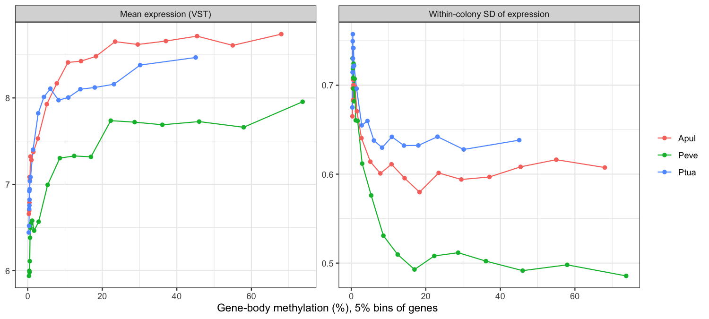

56-within-colony-methylation-expression
================
Steven Roberts
2026-11-23

- [1 Goal](#1-goal)
- [2 Inputs](#2-inputs)
- [3 Analysis](#3-analysis)
  - [3.1 1. Across genes](#31-1-across-genes)
  - [3.2 2. Between colonies](#32-2-between-colonies)
  - [3.3 3. Within colonies](#33-3-within-colonies)
  - [3.4 Strongest coupled genes](#34-strongest-coupled-genes)

# 1 Goal

`55-variance-partitioning` showed that gene-body methylation varies
mostly among colonies and very little with shared time, while expression
tracks time much more. That leaves open whether methylation and
expression **change together within a colony** over time. This script
tests that directly for every gene that has both gene-body methylation
and expression.

Three levels are examined:

1.  **Across genes** - are more methylated genes more highly expressed,
    and less variable over time? (the classic gene-body methylation
    pattern)
2.  **Between colonies** - for a given gene, do colonies with higher
    methylation have higher expression? (10 colonies per gene, so low
    power per gene; the distribution across genes is what matters)
3.  **Within colonies** - when a colony’s methylation of a gene goes up
    from one timepoint to another, does its expression of that gene move
    with it? Tested two ways:
    - **within colony**: both layers centred on each colony’s mean, so
      this includes change shared by all colonies (season)
    - **within colony, net of shared time**: site-by-timepoint means
      also removed, leaving only colony-specific change. This is the
      stricter test of gene-specific coupling.

The null for the within-colony tests comes from shuffling methylation
samples among timepoints within each colony, the same shuffle for every
gene, which keeps the correlation among genes intact.

``` r
knitr::opts_chunk$set(echo = TRUE, message = FALSE, warning = FALSE,
                      fig.width = 10, fig.height = 6, dpi = 150)
library(data.table)
library(DESeq2)
library(ggplot2)
library(matrixStats)

out_dir  <- "../output/56-within-colony-methylation-expression"
meth_dir <- "../output/55-variance-partitioning"   # gene-body methylation from 55.1
dir.create(out_dir, showWarnings = FALSE, recursive = TRUE)
n_perm <- 1000
set.seed(56)
```

# 2 Inputs

Gene-body methylation (mean % over at least 10 CpGs per gene and sample)
comes from `55.1-gene-body-methylation.py`, run by
`55-variance-partitioning.Rmd`. Only genes with a methylation value in
every sample shared by both layers are used, so every gene is tested on
the same samples.

``` r
meta <- fread("../../master-molecular-metadata.csv")
meta[, sample := paste(colony, timepoint, sep = "-")]
meta[, st := paste(site, timepoint, sep = ":")]
# Sample identity from 58-genotype-methylation: drop samples whose genotype
# does not match their colony label, and give clonemates one shared genotype,
# which is used as "colony" in every model below.
geno <- fread("../output/58-genotype-methylation/sample-genotypes.csv")
meta <- meta[!sample %in% geno[exclude == TRUE, sample]]
meta[unique(geno[exclude == FALSE, .(colony, genotype_id)]), colony := i.genotype_id, on = "colony"]
setkey(meta, sample)

canon <- function(x) {
  hit <- grepl("(ACR|POR|POC)-[0-9]+[-_]TP[1-4]", x)
  out <- rep(NA_character_, length(x))
  out[hit] <- sub("_", "-", regmatches(x, regexpr("(ACR|POR|POC)-[0-9]+[-_]TP[1-4]", x)))
  out
}
as_matrix <- function(dt) {
  keep <- names(dt)[-1]; s <- canon(keep)
  keep <- keep[!is.na(s)]; s <- s[!is.na(s)]
  m <- as.matrix(dt[, ..keep]); storage.mode(m) <- "double"
  if (anyDuplicated(s)) m <- t(rowsum(t(m), s)) else colnames(m) <- s
  rownames(m) <- dt[[1]]
  m <- m[, colnames(m) %in% meta$sample, drop = FALSE]   # excluded samples (see 58)
  m[, sort(colnames(m)), drop = FALSE]
}
vst_counts <- function(m, min_count = 10) {
  m <- round(m)
  m <- m[rowSums(m >= min_count) >= ceiling(ncol(m) / 4), , drop = FALSE]
  dds <- DESeqDataSetFromMatrix(m, data.frame(row.names = colnames(m)), ~ 1)
  dds <- estimateSizeFactors(dds, type = "poscounts")
  assay(varianceStabilizingTransformation(dds, blind = TRUE))
}

sp <- list(
  Apul = "../../D-Apul/output/02.20-D-Apul-RNAseq-alignment-HiSat2/apul-gene_count_matrix.csv",
  Peve = "../../E-Peve/output/02.20-E-Peve-RNAseq-alignment-HiSat2/peve-gene_count_matrix.csv",
  Ptua = "../../F-Ptua/output/02.20-F-Ptua-RNAseq-alignment-HiSat2/ptua-gene_count_matrix.csv"
)
```

# 3 Analysis

``` r
# residuals of every row of Y after regressing on design X (rank-safe)
resid_rows <- function(Y, X) {
  q <- qr(X); Q <- qr.Q(q)[, seq_len(q$rank), drop = FALSE]
  Y - (Y %*% Q) %*% t(Q)
}
rowcor <- function(A, B) rowSums(A * B) / sqrt(rowSums(A^2) * rowSums(B^2))
p_from_r <- function(r, df) 2 * pt(-abs(r * sqrt(df / (1 - r^2))), df)
shuffle_within <- function(groups) {
  idx <- seq_along(groups)
  for (g in split(idx, groups)) if (length(g) > 1) idx[g] <- g[sample.int(length(g))]
  idx
}
meth_classes <- function(x) cut(x, c(-Inf, 5, 20, Inf), labels = c("<5%", "5-20%", ">20%"))
```

``` r
per_gene <- list(); perm_stats <- list(); inputs <- list()

for (s in names(sp)) {
  E <- vst_counts(as_matrix(fread(sp[[s]])))
  M <- as_matrix(fread(file.path(meth_dir, paste0(s, "-gene-body-methylation.csv.gz"))))
  smp <- intersect(colnames(E), colnames(M))
  genes <- intersect(rownames(E), rownames(M))
  M <- M[genes, smp, drop = FALSE]
  M <- M[rowSums(is.na(M)) == 0 & rowVars(M) > 0, , drop = FALSE]
  E <- E[rownames(M), smp, drop = FALSE]
  md <- meta[smp]
  colony <- factor(md$colony)
  n <- length(smp)
  inputs[[s]] <- data.table(species = s, samples = n, colonies = nlevels(colony),
                            genes = nrow(M), genes_methylated_5pct = sum(rowMeans(M) >= 5))

  designs <- list(within_colony          = model.matrix(~ colony),
                  within_colony_net_time = model.matrix(~ colony + st, md))
  cls <- meth_classes(rowMeans(M))
  res <- data.table(species = s, gene = rownames(M), mean_meth = rowMeans(M),
                    meth_class = cls, mean_expr = rowMeans(E))

  # 1. within-colony variability of expression (plasticity)
  Ewc <- resid_rows(E, designs$within_colony)
  res[, expr_within_colony_sd := sqrt(rowSums(Ewc^2) / (n - nlevels(colony)))]

  # 2. between colonies: correlation of colony means
  cm <- function(Y) t(rowsum(t(Y), colony) / as.vector(table(colony)))
  res[, r_between := rowcor(cm(M) - rowMeans(cm(M)), cm(E) - rowMeans(cm(E)))]

  # 3. within colonies, with permutation null
  for (d in names(designs)) {
    X <- designs[[d]]
    df <- n - qr(X)$rank - 1
    Er <- resid_rows(E, X)
    r <- rowcor(resid_rows(M, X), Er)
    res[, (paste0("r_", d)) := r]
    res[, (paste0("p_", d)) := p_from_r(r, df)]

    perm <- rbindlist(lapply(seq_len(n_perm), function(b) {
      rp <- rowcor(resid_rows(M[, shuffle_within(colony), drop = FALSE], X), Er)
      pp <- p_from_r(rp, df)
      rbind(data.table(meth_class = "all", mean_r = mean(rp), n_p01 = sum(pp < 0.01)),
            data.table(meth_class = as.character(cls), rp, pp)[
              , .(mean_r = mean(rp), n_p01 = sum(pp < 0.01)), by = meth_class])
    }), idcol = "perm")
    perm_stats[[paste(s, d)]] <- cbind(species = s, test = d, perm)
  }
  per_gene[[s]] <- res
}

per_gene <- rbindlist(per_gene)
for (d in c("within_colony", "within_colony_net_time"))
  per_gene[, (paste0("fdr_", d)) := p.adjust(get(paste0("p_", d)), "BH"), by = species]
perm_stats <- rbindlist(perm_stats)
fwrite(per_gene, file.path(out_dir, "per-gene-methylation-expression.csv.gz"))
knitr::kable(rbindlist(inputs), caption = "Genes and samples analysed")
```

| species | samples | colonies | genes | genes_methylated_5pct |
|:--------|--------:|---------:|------:|----------------------:|
| Apul    |      37 |        8 | 13180 |                  6945 |
| Peve    |      35 |       10 |  7446 |                  3576 |
| Ptua    |      31 |       10 | 17144 |                  6936 |

Genes and samples analysed

## 3.1 1. Across genes

Spearman correlations across genes between mean gene-body methylation
and (a) mean expression, (b) within-colony standard deviation of
expression.

``` r
across <- per_gene[, .(
  genes = .N,
  rho_meth_vs_mean_expr = cor(mean_meth, mean_expr, method = "spearman"),
  rho_meth_vs_expr_sd = cor(mean_meth, expr_within_colony_sd, method = "spearman"),
  rho_meth_vs_expr_sd_given_mean = {
    # partial: expression variability adjusted for expression level
    a <- resid(lm(rank(expr_within_colony_sd) ~ rank(mean_expr)))
    b <- resid(lm(rank(mean_meth) ~ rank(mean_expr)))
    cor(a, b)
  }), by = species]
fwrite(across, file.path(out_dir, "across-genes.csv"))
knitr::kable(across, digits = 3)
```

| species | genes | rho_meth_vs_mean_expr | rho_meth_vs_expr_sd | rho_meth_vs_expr_sd_given_mean |
|:---|---:|---:|---:|---:|
| Apul | 13180 | 0.453 | -0.177 | -0.198 |
| Peve | 7446 | 0.399 | -0.407 | -0.356 |
| Ptua | 17144 | 0.386 | -0.143 | -0.186 |

``` r
per_gene[, bin := cut(frank(mean_meth) / .N, seq(0, 1, 0.05)), by = species]
binned <- per_gene[, .(mean_expr = mean(mean_expr), expr_sd = mean(expr_within_colony_sd),
                       mean_meth = mean(mean_meth), genes = .N), by = .(species, bin)]
per_gene[, bin := NULL]
bl <- melt(binned, id.vars = c("species", "bin", "mean_meth", "genes"),
           measure.vars = c("mean_expr", "expr_sd"))
bl[, variable := factor(variable, c("mean_expr", "expr_sd"),
                        c("Mean expression (VST)", "Within-colony SD of expression"))]
p1 <- ggplot(bl, aes(mean_meth, value, colour = species)) +
  geom_line() + geom_point(size = 1.5) +
  facet_wrap(~ variable, scales = "free_y") +
  labs(x = "Gene-body methylation (%), 5% bins of genes", y = NULL, colour = NULL) +
  theme_bw()
ggsave(file.path(out_dir, "across-genes.png"), p1, width = 10, height = 4.5, dpi = 200)
p1
```

<!-- -->

## 3.2 2. Between colonies

``` r
between <- per_gene[, .(genes = .N, mean_r = mean(r_between),
                        frac_positive = mean(r_between > 0)), by = .(species, meth_class)]
setorder(between, species, meth_class)
knitr::kable(between, digits = 3)
```

| species | meth_class | genes | mean_r | frac_positive |
|:--------|:-----------|------:|-------:|--------------:|
| Apul    | \<5%       |  6235 |  0.006 |         0.509 |
| Apul    | 5-20%      |  2895 |  0.076 |         0.575 |
| Apul    | \>20%      |  4050 |  0.055 |         0.552 |
| Peve    | \<5%       |  3870 |  0.013 |         0.513 |
| Peve    | 5-20%      |  1374 |  0.059 |         0.541 |
| Peve    | \>20%      |  2202 |  0.033 |         0.538 |
| Ptua    | \<5%       | 10208 |  0.008 |         0.511 |
| Ptua    | 5-20%      |  4325 |  0.019 |         0.516 |
| Ptua    | \>20%      |  2611 |  0.012 |         0.503 |

## 3.3 3. Within colonies

For each test: the mean within-colony correlation across genes, the
number of genes with nominal p \< 0.01, the number expected under the
permutation null, and permutation p-values for both statistics.

``` r
obs <- rbindlist(lapply(c("within_colony", "within_colony_net_time"), function(d) {
  x <- per_gene[, .(species, meth_class = as.character(meth_class),
                    r = get(paste0("r_", d)), p = get(paste0("p_", d)),
                    fdr = get(paste0("fdr_", d)))]
  rbind(x[, .(meth_class = "all", genes = .N, mean_r = mean(r), n_p01 = sum(p < 0.01),
              n_fdr10 = sum(fdr < 0.1)), by = species],
        x[, .(genes = .N, mean_r = mean(r), n_p01 = sum(p < 0.01),
              n_fdr10 = sum(fdr < 0.1)), by = .(species, meth_class)])[, test := d]
}))
keys <- c("species", "test", "meth_class")
pp <- merge(perm_stats, obs[, .(species, test, meth_class, obs_r = mean_r, obs_n = n_p01)],
            by = keys)
null <- pp[, .(null_mean_r = mean(mean_r),
               null_n_p01 = mean(n_p01),
               # two-sided for the mean correlation, one-sided (excess) for the count
               perm_p_mean_r = (1 + sum(abs(mean_r - mean(mean_r)) >=
                                          abs(obs_r[1] - mean(mean_r)))) / (n_perm + 1),
               perm_p_n_p01 = (1 + sum(n_p01 >= obs_n[1])) / (n_perm + 1)), by = keys]
within <- merge(obs, null, by = keys)
within[, meth_class := factor(meth_class, c("all", "<5%", "5-20%", ">20%"))]
setorder(within, test, species, meth_class)
fwrite(within, file.path(out_dir, "within-colony-summary.csv"))
knitr::kable(within[, .(test, species, meth_class, genes, mean_r, null_mean_r, perm_p_mean_r,
                        n_p01, null_n_p01, perm_p_n_p01, n_fdr10)], digits = 3)
```

| test | species | meth_class | genes | mean_r | null_mean_r | perm_p_mean_r | n_p01 | null_n_p01 | perm_p_n_p01 | n_fdr10 |
|:---|:---|:---|---:|---:|---:|---:|---:|---:|---:|---:|
| within_colony | Apul | all | 13180 | 0.005 | 0.000 | 0.571 | 924 | 139.752 | 0.001 | 580 |
| within_colony | Apul | \<5% | 6235 | -0.012 | 0.000 | 0.373 | 120 | 66.498 | 0.004 | 59 |
| within_colony | Apul | 5-20% | 2895 | 0.014 | 0.001 | 0.405 | 284 | 29.003 | 0.001 | 179 |
| within_colony | Apul | \>20% | 4050 | 0.024 | 0.001 | 0.246 | 520 | 44.251 | 0.001 | 342 |
| within_colony | Peve | all | 7446 | 0.015 | -0.001 | 0.022 | 83 | 68.864 | 0.105 | 0 |
| within_colony | Peve | \<5% | 3870 | 0.000 | -0.001 | 0.975 | 30 | 37.896 | 0.912 | 0 |
| within_colony | Peve | 5-20% | 1374 | 0.044 | -0.001 | 0.004 | 18 | 11.476 | 0.080 | 0 |
| within_colony | Peve | \>20% | 2202 | 0.025 | -0.001 | 0.028 | 35 | 19.492 | 0.028 | 0 |
| within_colony | Ptua | all | 17144 | 0.012 | 0.001 | 0.256 | 352 | 227.402 | 0.011 | 5 |
| within_colony | Ptua | \<5% | 10208 | 0.024 | 0.001 | 0.019 | 171 | 121.827 | 0.004 | 0 |
| within_colony | Ptua | 5-20% | 4325 | -0.007 | 0.000 | 0.728 | 115 | 65.034 | 0.025 | 1 |
| within_colony | Ptua | \>20% | 2611 | -0.007 | 0.001 | 0.767 | 66 | 40.541 | 0.053 | 4 |
| within_colony_net_time | Apul | all | 13180 | -0.006 | 0.000 | 0.421 | 443 | 133.094 | 0.001 | 23 |
| within_colony_net_time | Apul | \<5% | 6235 | -0.012 | 0.000 | 0.444 | 99 | 64.547 | 0.005 | 0 |
| within_colony_net_time | Apul | 5-20% | 2895 | 0.008 | 0.000 | 0.665 | 103 | 26.902 | 0.003 | 3 |
| within_colony_net_time | Apul | \>20% | 4050 | -0.007 | 0.001 | 0.702 | 241 | 41.645 | 0.001 | 20 |
| within_colony_net_time | Peve | all | 7446 | 0.005 | 0.000 | 0.479 | 83 | 68.416 | 0.092 | 0 |
| within_colony_net_time | Peve | \<5% | 3870 | -0.005 | 0.000 | 0.512 | 42 | 38.030 | 0.279 | 0 |
| within_colony_net_time | Peve | 5-20% | 1374 | 0.030 | 0.000 | 0.025 | 15 | 11.626 | 0.211 | 0 |
| within_colony_net_time | Peve | \>20% | 2202 | 0.008 | 0.000 | 0.435 | 26 | 18.760 | 0.118 | 0 |
| within_colony_net_time | Ptua | all | 17144 | 0.006 | 0.000 | 0.655 | 276 | 208.574 | 0.031 | 10 |
| within_colony_net_time | Ptua | \<5% | 10208 | 0.025 | 0.000 | 0.072 | 128 | 113.529 | 0.169 | 3 |
| within_colony_net_time | Ptua | 5-20% | 4325 | -0.022 | 0.001 | 0.361 | 97 | 58.273 | 0.015 | 2 |
| within_colony_net_time | Ptua | \>20% | 2611 | -0.024 | 0.001 | 0.414 | 51 | 36.772 | 0.111 | 5 |

``` r
hl <- melt(per_gene, id.vars = c("species", "gene", "meth_class"),
           measure.vars = c("r_within_colony", "r_within_colony_net_time"),
           variable.name = "test", value.name = "r")
hl[, test := sub("^r_", "", test)]
p2 <- ggplot(hl[meth_class != "<5%"], aes(r, fill = species)) +
  geom_histogram(binwidth = 0.05, boundary = 0, alpha = 0.8) +
  geom_vline(xintercept = 0, linetype = 2) +
  facet_grid(test ~ species, scales = "free_y") +
  labs(x = "Within-colony correlation of methylation and expression (genes >= 5% methylated)",
       y = "Genes") +
  theme_bw() + theme(legend.position = "none")
ggsave(file.path(out_dir, "within-colony-r.png"), p2, width = 10, height = 6, dpi = 200)
p2
```

<!-- -->

## 3.4 Strongest coupled genes

Genes at 10% FDR in the stricter test (colony-specific change), if any.

``` r
top <- per_gene[fdr_within_colony_net_time < 0.1][order(species, p_within_colony_net_time)]
fwrite(top, file.path(out_dir, "coupled-genes-fdr10.csv"))
if (nrow(top)) knitr::kable(top[, .(species, gene, mean_meth, r_within_colony_net_time,
                                    p_within_colony_net_time, fdr_within_colony_net_time)],
                            digits = 4) else cat("No genes at FDR < 0.1.\n")
```

| species | gene | mean_meth | r_within_colony_net_time | p_within_colony_net_time | fdr_within_colony_net_time |
|:---|:---|---:|---:|---:|---:|
| Apul | FUN_000537 | 22.9757 | 0.8191 | 0e+00 | 0.0232 |
| Apul | FUN_000352 | 29.1887 | -0.8050 | 0e+00 | 0.0238 |
| Apul | FUN_009661 | 74.7798 | -0.7917 | 0e+00 | 0.0299 |
| Apul | FUN_016780 | 67.9855 | 0.7723 | 0e+00 | 0.0519 |
| Apul | FUN_041965 | 56.5852 | 0.7625 | 0e+00 | 0.0616 |
| Apul | FUN_014770 | 71.4328 | 0.7516 | 0e+00 | 0.0731 |
| Apul | FUN_004400 | 22.8270 | 0.7468 | 0e+00 | 0.0731 |
| Apul | FUN_024778 | 57.5769 | -0.7403 | 1e-04 | 0.0731 |
| Apul | FUN_007759 | 63.0071 | -0.7397 | 1e-04 | 0.0731 |
| Apul | FUN_023795 | 47.7644 | -0.7394 | 1e-04 | 0.0731 |
| Apul | FUN_005725 | 67.2549 | 0.7320 | 1e-04 | 0.0732 |
| Apul | FUN_042656 | 38.4020 | 0.7292 | 1e-04 | 0.0732 |
| Apul | FUN_038220 | 24.7750 | -0.7287 | 1e-04 | 0.0732 |
| Apul | FUN_009304 | 53.6574 | -0.7276 | 1e-04 | 0.0732 |
| Apul | FUN_035276 | 65.2144 | -0.7272 | 1e-04 | 0.0732 |
| Apul | FUN_034363 | 5.6770 | -0.7238 | 1e-04 | 0.0732 |
| Apul | FUN_008936 | 64.5546 | 0.7207 | 1e-04 | 0.0732 |
| Apul | FUN_031709 | 64.9131 | -0.7201 | 1e-04 | 0.0732 |
| Apul | FUN_026369 | 14.5564 | -0.7190 | 1e-04 | 0.0732 |
| Apul | FUN_022869 | 8.2471 | 0.7189 | 1e-04 | 0.0732 |
| Apul | FUN_015256 | 51.0756 | -0.7127 | 1e-04 | 0.0850 |
| Apul | FUN_023189 | 42.0989 | 0.7103 | 1e-04 | 0.0875 |
| Apul | FUN_033691 | 60.4542 | -0.7059 | 2e-04 | 0.0961 |
| Ptua | gene-Pocillopora_meandrina_HIv1\_\_\_RNAseq.g1587.t1 | 30.2660 | -0.9021 | 0e+00 | 0.0304 |
| Ptua | gene-Pocillopora_meandrina_HIv1\_\_\_RNAseq.g17956.t1 | 21.3344 | -0.8857 | 0e+00 | 0.0391 |
| Ptua | gene-Pocillopora_meandrina_HIv1\_\_\_RNAseq.g28040.t1 | 21.8238 | 0.8803 | 0e+00 | 0.0391 |
| Ptua | gene-Pocillopora_meandrina_HIv1\_\_\_RNAseq.g1814.t1 | 37.8020 | -0.8638 | 0e+00 | 0.0693 |
| Ptua | gene-Pocillopora_meandrina_HIv1\_\_\_RNAseq.g10783.t1a | 16.1290 | -0.8501 | 0e+00 | 0.0827 |
| Ptua | gene-Pocillopora_meandrina_HIv1\_\_\_RNAseq.g25681.t1 | 2.2689 | 0.8481 | 0e+00 | 0.0827 |
| Ptua | gene-Pocillopora_meandrina_HIv1\_\_\_RNAseq.3753_t | 0.6178 | 0.8472 | 0e+00 | 0.0827 |
| Ptua | gene-Pocillopora_meandrina_HIv1\_\_\_RNAseq.g4541.t1 | 6.9553 | -0.8419 | 0e+00 | 0.0827 |
| Ptua | gene-Pocillopora_meandrina_HIv1\_\_\_RNAseq.g3784.t1 | 0.7511 | 0.8408 | 0e+00 | 0.0827 |
| Ptua | gene-Pocillopora_meandrina_HIv1\_\_\_RNAseq.g1582.t1 | 25.6670 | -0.8392 | 0e+00 | 0.0827 |

``` r
sessionInfo()
```

    ## R version 4.5.1 (2025-06-13)
    ## Platform: aarch64-apple-darwin20
    ## Running under: macOS Sequoia 15.6.1
    ## 
    ## Matrix products: default
    ## BLAS:   /Library/Frameworks/R.framework/Versions/4.5-arm64/Resources/lib/libRblas.0.dylib 
    ## LAPACK: /Library/Frameworks/R.framework/Versions/4.5-arm64/Resources/lib/libRlapack.dylib;  LAPACK version 3.12.1
    ## 
    ## locale:
    ## [1] en_US/en_US/en_US/C/en_US/en_US
    ## 
    ## time zone: America/Los_Angeles
    ## tzcode source: internal
    ## 
    ## attached base packages:
    ## [1] stats4    stats     graphics  grDevices utils     datasets  methods  
    ## [8] base     
    ## 
    ## other attached packages:
    ##  [1] ggplot2_4.0.1               DESeq2_1.50.2              
    ##  [3] SummarizedExperiment_1.40.0 Biobase_2.70.0             
    ##  [5] MatrixGenerics_1.22.0       matrixStats_1.5.0          
    ##  [7] GenomicRanges_1.62.1        Seqinfo_1.0.0              
    ##  [9] IRanges_2.44.0              S4Vectors_0.48.0           
    ## [11] BiocGenerics_0.56.0         generics_0.1.4             
    ## [13] data.table_1.17.8          
    ## 
    ## loaded via a namespace (and not attached):
    ##  [1] rappdirs_0.3.3      SparseArray_1.10.10 lattice_0.22-7     
    ##  [4] digest_0.6.39       magrittr_2.0.4      evaluate_1.0.5     
    ##  [7] grid_4.5.1          RColorBrewer_1.1-3  fastmap_1.2.0      
    ## [10] R.oo_1.27.1         jsonlite_2.0.0      Matrix_1.7-4       
    ## [13] R.utils_2.13.0      scales_1.4.0        coro_1.1.0         
    ## [16] textshaping_1.0.4   codetools_0.2-20    httr2_1.2.1        
    ## [19] abind_1.4-8         cli_3.6.5           rlang_1.3.0        
    ## [22] XVector_0.50.0      R.methodsS3_1.8.2   withr_3.0.2        
    ## [25] DelayedArray_0.36.1 yaml_2.3.10         S4Arrays_1.10.1    
    ## [28] tools_4.5.1         parallel_4.5.1      BiocParallel_1.44.0
    ## [31] dplyr_1.2.1         locfit_1.5-9.12     curl_7.0.0         
    ## [34] vctrs_0.7.3         R6_2.6.1            lifecycle_1.0.5    
    ## [37] ragg_1.5.0          pkgconfig_2.0.3     pillar_1.11.1      
    ## [40] gtable_0.3.6        glue_1.8.0          Rcpp_1.1.2         
    ## [43] systemfonts_1.3.1   tidyselect_1.2.1    xfun_0.54          
    ## [46] tibble_3.3.0        knitr_1.50          farver_2.1.2       
    ## [49] htmltools_0.5.8.1   labeling_0.4.3      rmarkdown_2.30     
    ## [52] ellmer_0.4.0        compiler_4.5.1      S7_0.2.1
