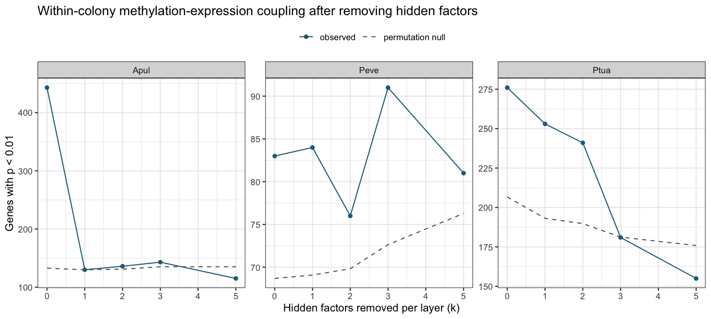

56.1-within-colony-adjusted
================
Steven Roberts
2026-11-23

- [1 Goal](#1-goal)
- [2 Inputs](#2-inputs)
- [3 Is there a shared sample-level
  axis?](#3-is-there-a-shared-sample-level-axis)
- [4 Re-test with adjustments](#4-re-test-with-adjustments)

# 1 Goal

`56-within-colony-methylation-expression` found more genes than expected
whose methylation and expression co-vary within colonies after removing
shared site-by-time change, most clearly in *A. pulchra*. Those
correlations were split evenly between positive and negative, which is
what a sample-level nuisance factor affecting both layers would produce,
rather than gene-specific regulation.

This script re-runs the strict test (`~ colony + site:timepoint`) with
extra sample-level covariates and asks whether the excess survives:

- **Hidden factors**: the top *k* principal components of each layer’s
  residuals (after colony and site:timepoint), from both layers, added
  to the design for both layers. *k* = 0 (the original test), 1, 2, 3,
  5.  
- **Symbiont load**: log10 symbiont cells per cm² and the symbiont:host
  biomass ratio from the physiology data.

If the excess is driven by a shared sample-level factor, it should
shrink toward the null as factors are removed. Genuine gene-specific
coupling should largely persist. Removing factors can also remove some
real signal, so a drop is suggestive, not proof.

The permutation null is rebuilt for every setting: methylation samples
are shuffled within colony and the methylation factors recomputed from
the shuffled data each time.

``` r
knitr::opts_chunk$set(echo = TRUE, message = FALSE, warning = FALSE,
                      fig.width = 10, fig.height = 6, dpi = 150)
library(data.table)
library(DESeq2)
library(ggplot2)
library(matrixStats)

out_dir  <- "../output/56.1-within-colony-adjusted"
meth_dir <- "../output/55-variance-partitioning"
dir.create(out_dir, showWarnings = FALSE, recursive = TRUE)
n_perm <- 1000
ks <- c(0, 1, 2, 3, 5)
set.seed(561)
```

# 2 Inputs

Same genes and samples as `56`: gene-body methylation with a value in
every sample shared with RNA-seq, and VST expression.

``` r
meta <- fread("../../master-molecular-metadata.csv")
meta[, sample := paste(colony, timepoint, sep = "-")]
meta[, st := paste(site, timepoint, sep = ":")]
# Sample identity from 58-genotype-methylation: drop samples whose genotype
# does not match their colony label, and give clonemates one shared genotype,
# which is used as "colony" in every model below.
geno <- fread("../output/58-genotype-methylation/sample-genotypes.csv")
meta <- meta[!sample %in% geno[exclude == TRUE, sample]]
meta[unique(geno[exclude == FALSE, .(colony, genotype_id)]), colony := i.genotype_id, on = "colony"]
setkey(meta, sample)

phys <- fread("../data/phys_master_timeseries.csv")
phys[, sample := paste(colony_id_corr, sub("timepoint", "TP", timepoint), sep = "-")]
phys <- unique(phys[, .(sample, log_sym_cells = log10(cells.cm2),
                        sym_host_ratio = Ratio_AFDW.mg.cm2)], by = "sample")
setkey(phys, sample)

canon <- function(x) {
  hit <- grepl("(ACR|POR|POC)-[0-9]+[-_]TP[1-4]", x)
  out <- rep(NA_character_, length(x))
  out[hit] <- sub("_", "-", regmatches(x, regexpr("(ACR|POR|POC)-[0-9]+[-_]TP[1-4]", x)))
  out
}
as_matrix <- function(dt) {
  keep <- names(dt)[-1]; s <- canon(keep)
  keep <- keep[!is.na(s)]; s <- s[!is.na(s)]
  m <- as.matrix(dt[, ..keep]); storage.mode(m) <- "double"
  if (anyDuplicated(s)) m <- t(rowsum(t(m), s)) else colnames(m) <- s
  rownames(m) <- dt[[1]]
  m <- m[, colnames(m) %in% meta$sample, drop = FALSE]   # excluded samples (see 58)
  m[, sort(colnames(m)), drop = FALSE]
}
vst_counts <- function(m, min_count = 10) {
  m <- round(m)
  m <- m[rowSums(m >= min_count) >= ceiling(ncol(m) / 4), , drop = FALSE]
  dds <- DESeqDataSetFromMatrix(m, data.frame(row.names = colnames(m)), ~ 1)
  dds <- estimateSizeFactors(dds, type = "poscounts")
  assay(varianceStabilizingTransformation(dds, blind = TRUE))
}
resid_rows <- function(Y, X) {
  q <- qr(X); Q <- qr.Q(q)[, seq_len(q$rank), drop = FALSE]
  Y - (Y %*% Q) %*% t(Q)
}
rowcor <- function(A, B) rowSums(A * B) / sqrt(rowSums(A^2) * rowSums(B^2))
p_from_r <- function(r, df) 2 * pt(-abs(r * sqrt(df / (1 - r^2))), df)
shuffle_within <- function(groups) {
  idx <- seq_along(groups)
  for (g in split(idx, groups)) if (length(g) > 1) idx[g] <- g[sample.int(length(g))]
  idx
}
# sample scores of the top k components of Y's residuals on X
top_scores <- function(Y, X, k) {
  if (k == 0) return(NULL)
  svd(resid_rows(Y, X), nu = 0, nv = k)$v
}

sp <- list(
  Apul = "../../D-Apul/output/02.20-D-Apul-RNAseq-alignment-HiSat2/apul-gene_count_matrix.csv",
  Peve = "../../E-Peve/output/02.20-E-Peve-RNAseq-alignment-HiSat2/peve-gene_count_matrix.csv",
  Ptua = "../../F-Ptua/output/02.20-F-Ptua-RNAseq-alignment-HiSat2/ptua-gene_count_matrix.csv"
)
data <- list()
for (s in names(sp)) {
  E <- vst_counts(as_matrix(fread(sp[[s]])))
  M <- as_matrix(fread(file.path(meth_dir, paste0(s, "-gene-body-methylation.csv.gz"))))
  smp <- intersect(colnames(E), colnames(M))
  M <- M[intersect(rownames(E), rownames(M)), smp, drop = FALSE]
  M <- M[rowSums(is.na(M)) == 0 & rowVars(M) > 0, , drop = FALSE]
  data[[s]] <- list(E = E[rownames(M), smp, drop = FALSE], M = M, md = meta[smp])
}
```

# 3 Is there a shared sample-level axis?

Before adjusting: how much residual variance do the leading components
carry in each layer, and do the methylation and expression components
line up with each other or with symbiont load? Correlations are across
samples.

``` r
diag <- rbindlist(lapply(names(data), function(s) {
  d <- data[[s]]; X <- model.matrix(~ colony + st, d$md)
  sv <- function(Y) svd(resid_rows(Y, X), nu = 0, nv = 3)
  e <- sv(d$E); m <- sv(d$M)
  ve <- function(Y, x) x$d[1:3]^2 / sum(resid_rows(Y, X)^2)
  sym <- phys[d$md$sample]
  rbindlist(lapply(1:3, function(i) data.table(
    species = s, component = i,
    expr_pct_resid_var = 100 * ve(d$E, e)[i],
    meth_pct_resid_var = 100 * ve(d$M, m)[i],
    max_abs_r_with_other_layer_top3 = max(abs(cor(e$v[, i], m$v[, 1:3]))),
    r_expr_pc_sym_cells = cor(e$v[, i], sym$log_sym_cells, use = "complete.obs"),
    r_meth_pc_sym_cells = cor(m$v[, i], sym$log_sym_cells, use = "complete.obs"))))
}))
fwrite(diag, file.path(out_dir, "residual-components.csv"))
knitr::kable(diag, digits = 2)
```

| species | component | expr_pct_resid_var | meth_pct_resid_var | max_abs_r_with_other_layer_top3 | r_expr_pc_sym_cells | r_meth_pc_sym_cells |
|:---|---:|---:|---:|---:|---:|---:|
| Apul | 1 | 22.55 | 43.39 | 0.63 | 0.11 | 0.04 |
| Apul | 2 | 9.92 | 7.05 | 0.34 | 0.06 | 0.05 |
| Apul | 3 | 8.83 | 6.12 | 0.15 | 0.09 | 0.09 |
| Peve | 1 | 21.66 | 20.12 | 0.28 | 0.07 | -0.05 |
| Peve | 2 | 14.44 | 9.94 | 0.23 | -0.05 | 0.06 |
| Peve | 3 | 10.71 | 9.56 | 0.31 | 0.01 | 0.04 |
| Ptua | 1 | 33.23 | 17.41 | 0.76 | 0.04 | 0.12 |
| Ptua | 2 | 15.37 | 11.79 | 0.49 | -0.15 | -0.08 |
| Ptua | 3 | 11.15 | 9.96 | 0.39 | 0.22 | 0.16 |

# 4 Re-test with adjustments

``` r
run_test <- function(d, extra = NULL, k) {
  X0 <- cbind(model.matrix(~ colony + st, d$md), extra)
  VE <- top_scores(d$E, X0, k)
  fit <- function(M, VM) {
    X <- cbind(X0, VE, VM)
    df <- nrow(d$md) - qr(X)$rank - 1
    r <- rowcor(resid_rows(M, X), resid_rows(d$E, X))
    list(r = r, p = p_from_r(r, df), df = df)
  }
  obs <- fit(d$M, top_scores(d$M, X0, k))
  null <- vapply(seq_len(n_perm), function(b) {
    Mp <- d$M[, shuffle_within(d$md$colony), drop = FALSE]
    sum(fit(Mp, top_scores(Mp, X0, k))$p < 0.01)
  }, numeric(1))
  sig <- obs$p < 0.01
  data.table(genes = length(obs$r), df = obs$df,
             mean_r = mean(obs$r), n_p01 = sum(sig),
             null_n_p01 = mean(null), excess = sum(sig) - mean(null),
             perm_p = (1 + sum(null >= sum(sig))) / (n_perm + 1),
             frac_positive_sig = mean(obs$r[sig] > 0),
             n_fdr10 = sum(p.adjust(obs$p, "BH") < 0.1))
}

results <- list()
for (s in names(data)) {
  d <- data[[s]]
  for (k in ks)
    results[[length(results) + 1]] <- cbind(species = s, adjustment = "hidden factors",
                                             k = k, samples = nrow(d$md), run_test(d, NULL, k))
  # symbiont covariates: only samples with both values, with a matching baseline
  sym <- phys[d$md$sample]
  ok <- complete.cases(sym[, .(log_sym_cells, sym_host_ratio)])
  ds <- list(E = d$E[, ok], M = d$M[, ok], md = d$md[ok])
  results[[length(results) + 1]] <- cbind(species = s, adjustment = "none (symbiont subset)",
                                           k = 0, samples = sum(ok), run_test(ds, NULL, 0))
  results[[length(results) + 1]] <- cbind(species = s, adjustment = "symbiont load",
                                           k = 0, samples = sum(ok),
                                           run_test(ds, as.matrix(sym[ok, .(log_sym_cells,
                                                                            sym_host_ratio)]), 0))
}
results <- rbindlist(results)
fwrite(results, file.path(out_dir, "adjusted-within-colony-summary.csv"))
knitr::kable(results, digits = 3)
```

| species | adjustment | k | samples | genes | df | mean_r | n_p01 | null_n_p01 | excess | perm_p | frac_positive_sig | n_fdr10 |
|:---|:---|---:|---:|---:|---:|---:|---:|---:|---:|---:|---:|---:|
| Apul | hidden factors | 0 | 37 | 13180 | 21 | -0.006 | 443 | 132.756 | 310.244 | 0.001 | 0.472 | 23 |
| Apul | hidden factors | 1 | 37 | 13180 | 19 | 0.000 | 130 | 129.894 | 0.106 | 0.508 | 0.477 | 0 |
| Apul | hidden factors | 2 | 37 | 13180 | 17 | 0.002 | 136 | 130.973 | 5.027 | 0.348 | 0.485 | 0 |
| Apul | hidden factors | 3 | 37 | 13180 | 15 | 0.006 | 143 | 135.101 | 7.899 | 0.281 | 0.462 | 0 |
| Apul | hidden factors | 5 | 37 | 13180 | 11 | 0.008 | 115 | 135.134 | -20.134 | 0.957 | 0.530 | 1 |
| Apul | none (symbiont subset) | 0 | 36 | 13180 | 20 | -0.003 | 516 | 139.510 | 376.490 | 0.001 | 0.459 | 59 |
| Apul | symbiont load | 0 | 36 | 13180 | 18 | -0.002 | 499 | 140.036 | 358.964 | 0.001 | 0.487 | 54 |
| Peve | hidden factors | 0 | 35 | 7446 | 18 | 0.005 | 83 | 68.687 | 14.313 | 0.115 | 0.542 | 0 |
| Peve | hidden factors | 1 | 35 | 7446 | 16 | -0.004 | 84 | 69.086 | 14.914 | 0.072 | 0.452 | 0 |
| Peve | hidden factors | 2 | 35 | 7446 | 14 | 0.001 | 76 | 69.827 | 6.173 | 0.265 | 0.513 | 1 |
| Peve | hidden factors | 3 | 35 | 7446 | 12 | 0.001 | 91 | 72.640 | 18.360 | 0.018 | 0.451 | 0 |
| Peve | hidden factors | 5 | 35 | 7446 | 8 | 0.003 | 81 | 76.292 | 4.708 | 0.322 | 0.420 | 0 |
| Peve | none (symbiont subset) | 0 | 35 | 7446 | 18 | 0.005 | 83 | 68.355 | 14.645 | 0.110 | 0.542 | 0 |
| Peve | symbiont load | 0 | 35 | 7446 | 16 | 0.004 | 71 | 68.305 | 2.695 | 0.399 | 0.493 | 0 |
| Ptua | hidden factors | 0 | 31 | 17144 | 14 | 0.006 | 276 | 206.657 | 69.343 | 0.027 | 0.482 | 10 |
| Ptua | hidden factors | 1 | 31 | 17144 | 12 | 0.004 | 253 | 193.150 | 59.850 | 0.002 | 0.530 | 0 |
| Ptua | hidden factors | 2 | 31 | 17144 | 10 | 0.006 | 241 | 189.793 | 51.207 | 0.003 | 0.515 | 0 |
| Ptua | hidden factors | 3 | 31 | 17144 | 8 | 0.004 | 181 | 181.208 | -0.208 | 0.519 | 0.492 | 0 |
| Ptua | hidden factors | 5 | 31 | 17144 | 4 | 0.012 | 155 | 175.889 | -20.889 | 0.950 | 0.490 | 0 |
| Ptua | none (symbiont subset) | 0 | 30 | 17144 | 13 | 0.004 | 265 | 207.730 | 57.270 | 0.086 | 0.453 | 4 |
| Ptua | symbiont load | 0 | 30 | 17144 | 11 | 0.000 | 255 | 199.431 | 55.569 | 0.067 | 0.447 | 7 |

``` r
hf <- results[adjustment == "hidden factors"]
p <- ggplot(hf, aes(k)) +
  geom_line(aes(y = n_p01, colour = "observed")) +
  geom_point(aes(y = n_p01, colour = "observed")) +
  geom_line(aes(y = null_n_p01, colour = "permutation null"), linetype = 2) +
  facet_wrap(~ species, scales = "free_y") +
  scale_colour_manual(values = c(observed = "#1b6e8a", `permutation null` = "grey40")) +
  labs(x = "Hidden factors removed per layer (k)", y = "Genes with p < 0.01",
       colour = NULL,
       title = "Within-colony methylation-expression coupling after removing hidden factors") +
  theme_bw() + theme(legend.position = "top")
ggsave(file.path(out_dir, "excess-vs-k.png"), p, width = 10, height = 4.5, dpi = 200)
p
```

<!-- -->

``` r
sessionInfo()
```

    ## R version 4.5.1 (2025-06-13)
    ## Platform: aarch64-apple-darwin20
    ## Running under: macOS Sequoia 15.6.1
    ## 
    ## Matrix products: default
    ## BLAS:   /Library/Frameworks/R.framework/Versions/4.5-arm64/Resources/lib/libRblas.0.dylib 
    ## LAPACK: /Library/Frameworks/R.framework/Versions/4.5-arm64/Resources/lib/libRlapack.dylib;  LAPACK version 3.12.1
    ## 
    ## locale:
    ## [1] en_US/en_US/en_US/C/en_US/en_US
    ## 
    ## time zone: America/Los_Angeles
    ## tzcode source: internal
    ## 
    ## attached base packages:
    ## [1] stats4    stats     graphics  grDevices utils     datasets  methods  
    ## [8] base     
    ## 
    ## other attached packages:
    ##  [1] ggplot2_4.0.1               DESeq2_1.50.2              
    ##  [3] SummarizedExperiment_1.40.0 Biobase_2.70.0             
    ##  [5] MatrixGenerics_1.22.0       matrixStats_1.5.0          
    ##  [7] GenomicRanges_1.62.1        Seqinfo_1.0.0              
    ##  [9] IRanges_2.44.0              S4Vectors_0.48.0           
    ## [11] BiocGenerics_0.56.0         generics_0.1.4             
    ## [13] data.table_1.17.8          
    ## 
    ## loaded via a namespace (and not attached):
    ##  [1] rappdirs_0.3.3      SparseArray_1.10.10 lattice_0.22-7     
    ##  [4] digest_0.6.39       magrittr_2.0.4      evaluate_1.0.5     
    ##  [7] grid_4.5.1          RColorBrewer_1.1-3  fastmap_1.2.0      
    ## [10] R.oo_1.27.1         jsonlite_2.0.0      Matrix_1.7-4       
    ## [13] R.utils_2.13.0      scales_1.4.0        coro_1.1.0         
    ## [16] textshaping_1.0.4   codetools_0.2-20    httr2_1.2.1        
    ## [19] abind_1.4-8         cli_3.6.5           rlang_1.3.0        
    ## [22] XVector_0.50.0      R.methodsS3_1.8.2   withr_3.0.2        
    ## [25] DelayedArray_0.36.1 yaml_2.3.10         S4Arrays_1.10.1    
    ## [28] tools_4.5.1         parallel_4.5.1      BiocParallel_1.44.0
    ## [31] dplyr_1.2.1         locfit_1.5-9.12     curl_7.0.0         
    ## [34] vctrs_0.7.3         R6_2.6.1            lifecycle_1.0.5    
    ## [37] ragg_1.5.0          pkgconfig_2.0.3     pillar_1.11.1      
    ## [40] gtable_0.3.6        glue_1.8.0          Rcpp_1.1.2         
    ## [43] systemfonts_1.3.1   tidyselect_1.2.1    xfun_0.54          
    ## [46] tibble_3.3.0        knitr_1.50          farver_2.1.2       
    ## [49] htmltools_0.5.8.1   labeling_0.4.3      rmarkdown_2.30     
    ## [52] ellmer_0.4.0        compiler_4.5.1      S7_0.2.1
