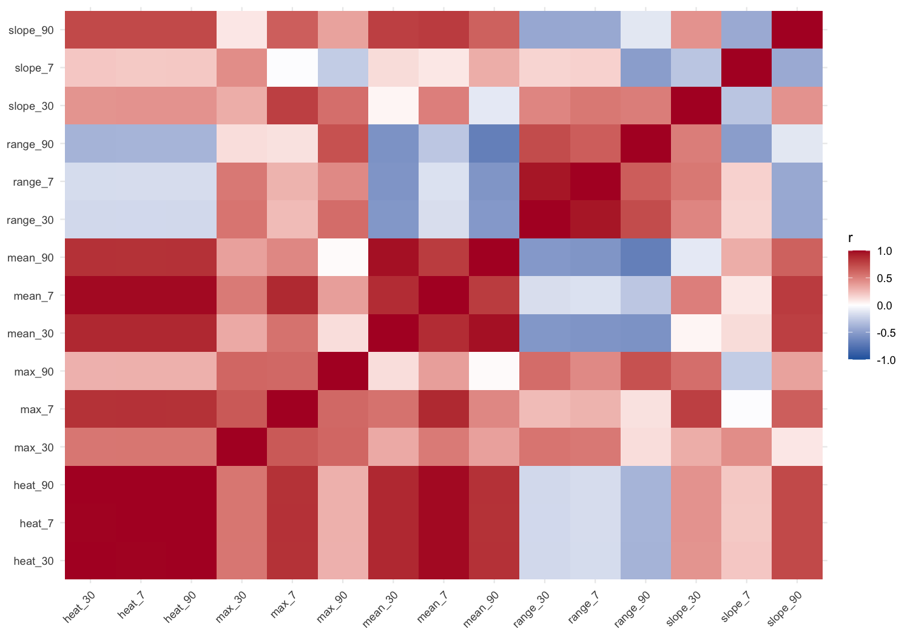
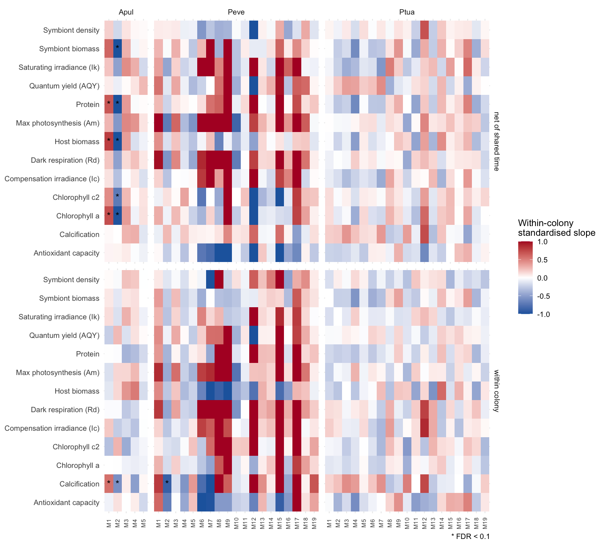
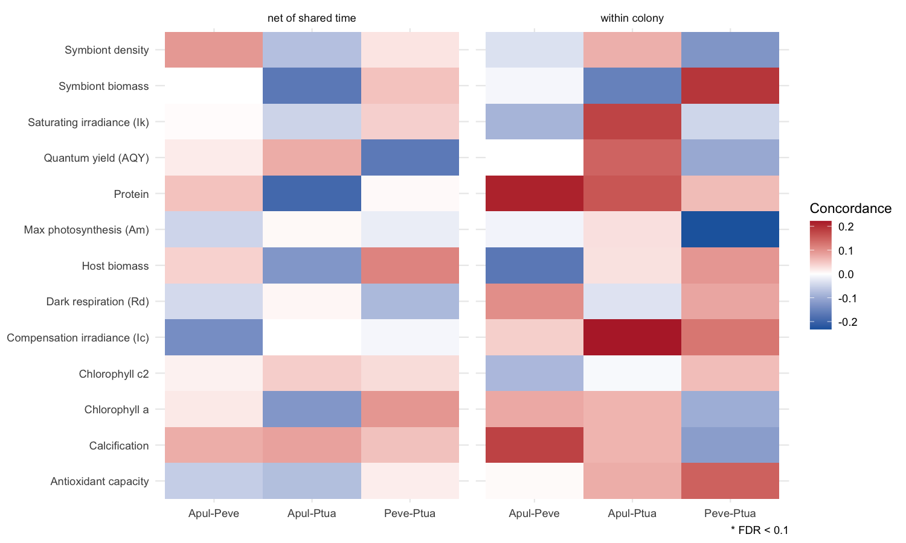

57-expression-physiology-thermal
================
Steven Roberts
2026-11-23

- [1 Goal](#1-goal)
  - [1.1 Caveats that apply
    throughout](#11-caveats-that-apply-throughout)
- [2 Thermal history](#2-thermal-history)
- [3 Expression modules](#3-expression-modules)
- [4 Modules vs physiology](#4-modules-vs-physiology)
- [5 Thermal history vs modules and
  physiology](#5-thermal-history-vs-modules-and-physiology)
- [6 Cross-species concordance through
  orthologs](#6-cross-species-concordance-through-orthologs)

# 1 Goal

`55`-`56.1` showed that gene-body methylation is a stable colony trait,
while expression and physiology change through time. This script asks
which expression programmes track which physiological changes, and how
both relate to the thermal history before each sampling.

1.  **Thermal history** at Manava and Mahana (the two sites with
    sequenced colonies) over the 7, 30 and 90 days before each sampling
    visit.
2.  **Expression modules** per species (signed WGCNA on VST expression).
3.  **Modules vs physiology** with repeated-measures mixed models,
    splitting each module into a between-colony and a within-colony
    part.
4.  **Thermal history vs modules and physiology** across the 8
    site-by-timepoint units.
5.  **Cross-species concordance**: do one-to-one orthologs relate to the
    same physiological trait in the same direction in all three species?

## 1.1 Caveats that apply throughout

- **Only 8 environmental states** (2 sites x 4 timepoints). Thermal
  metrics cannot be separated from anything else that changes with
  season (light, nutrients, reproduction). Section 4 identifies which
  seasonal axis a module follows, consistent with temperature; it does
  not establish that temperature causes it.
- **Sampling dates are approximate.** The sample sheets record month
  only. Each window ends on the last logger reading before the
  field-visit gap in the temperature record (`visit_end` below). The
  90-day TP1 window is partly before logger deployment (61 of 90 days
  covered).
- **Within-colony associations include shared seasonal change.** The
  “net of time” models remove site-by-timepoint means and test only
  colony-specific co-variation.

``` r
knitr::opts_chunk$set(echo = TRUE, message = FALSE, warning = FALSE,
                      fig.width = 10, fig.height = 6, dpi = 150)
library(data.table)
library(DESeq2)
library(lme4)
library(lmerTest)
library(ggplot2)
library(matrixStats)
# WGCNA is used through WGCNA:: only; attaching it masks stats::cor()

out_dir <- "../output/57-expression-physiology-thermal"
dir.create(out_dir, showWarnings = FALSE, recursive = TRUE)
set.seed(57)
WGCNA::enableWGCNAThreads(nThreads = 8)
```

    ## Allowing parallel execution with up to 8 working processes.

``` r
n_perm <- 1000
n_net_genes <- 10000   # most variable genes per species used to build networks

temp_url <- "https://raw.githubusercontent.com/urol-e5/MOSAiC/main/data/temperature_timeseries.csv"
visit_end <- as.Date(c(TP1 = "2019-12-30", TP2 = "2020-02-29",
                       TP3 = "2020-09-18", TP4 = "2020-11-07"))
windows <- c(7, 30, 90)
heat_threshold <- 29   # degrees C, for accumulated heat above threshold
```

# 2 Thermal history

Daily summaries use local time (UTC-10). For each site, timepoint and
window:

- `mean`: mean of daily mean temperature
- `max`: highest single reading
- `range`: mean daily range (max - min)
- `heat`: accumulated degree-days above 29 C, scaled to the full window
  length when coverage is incomplete
- `slope`: trend in daily mean (C per week)

``` r
temp <- fread(temp_url)
temp[, t := as.POSIXct(date.time, format = "%Y-%m-%dT%H:%M:%SZ", tz = "UTC")]
temp <- temp[site %in% c("Manava", "Mahana") & between(temp.C, 10, 40)]
temp[, day := as.Date(t - 10 * 3600)]
daily <- temp[, .(tmean = mean(temp.C), tmax = max(temp.C), tmin = min(temp.C)),
              by = .(site, day)]

thermal_long <- rbindlist(lapply(c("Manava", "Mahana"), function(s)
  rbindlist(lapply(names(visit_end), function(tp)
    rbindlist(lapply(windows, function(w) {
      d <- daily[site == s & day <= visit_end[tp] & day > visit_end[tp] - w]
      data.table(site = s, timepoint = tp, window = w, days_covered = nrow(d),
                 mean = mean(d$tmean), max = max(d$tmax),
                 range = mean(d$tmax - d$tmin),
                 heat = mean(pmax(d$tmean - heat_threshold, 0)) * w,
                 slope = 7 * coef(lm(tmean ~ as.numeric(day), d))[[2]])
    }))))))
fwrite(thermal_long, file.path(out_dir, "thermal-history.csv"))

thermal <- dcast(melt(thermal_long, id.vars = c("site", "timepoint", "window", "days_covered"),
                      variable.name = "metric"),
                 site + timepoint ~ metric + window, value.var = "value", sep = "_")
thermal[, st := paste(site, timepoint, sep = ":")]
metric_cols <- setdiff(names(thermal), c("site", "timepoint", "st"))
knitr::kable(thermal[, c("st", metric_cols), with = FALSE], digits = 2)
```

| st | mean_7 | mean_30 | mean_90 | max_7 | max_30 | max_90 | range_7 | range_30 | range_90 | heat_7 | heat_30 | heat_90 | slope_7 | slope_30 | slope_90 |
|:---|---:|---:|---:|---:|---:|---:|---:|---:|---:|---:|---:|---:|---:|---:|---:|
| Mahana:TP1 | 27.55 | 28.00 | 27.94 | 28.52 | 29.99 | 29.99 | 0.78 | 0.86 | 0.93 | 0.00 | 0.03 | 0.04 | -0.41 | -0.38 | 0.00 |
| Mahana:TP2 | 29.55 | 29.00 | 28.54 | 30.80 | 30.80 | 30.80 | 1.32 | 1.03 | 0.98 | 3.83 | 4.48 | 7.23 | -0.39 | 0.25 | 0.11 |
| Mahana:TP3 | 27.63 | 27.11 | 27.19 | 29.72 | 31.33 | 31.33 | 3.27 | 2.01 | 1.56 | 0.00 | 0.00 | 0.00 | -0.18 | 0.17 | -0.04 |
| Mahana:TP4 | 27.82 | 27.59 | 27.33 | 29.24 | 29.49 | 31.33 | 1.34 | 1.25 | 1.60 | 0.00 | 0.00 | 0.00 | -0.81 | 0.21 | 0.07 |
| Manava:TP1 | 27.47 | 27.99 | 27.95 | 28.04 | 29.48 | 29.48 | 0.60 | 0.65 | 0.75 | 0.00 | 0.00 | 0.00 | -0.06 | -0.38 | 0.00 |
| Manava:TP2 | 29.53 | 29.04 | 28.56 | 30.72 | 30.72 | 30.72 | 1.23 | 0.97 | 0.89 | 3.71 | 4.80 | 7.25 | -0.17 | 0.23 | 0.12 |
| Manava:TP3 | 27.56 | 27.04 | 27.18 | 29.11 | 29.61 | 29.61 | 2.16 | 1.41 | 1.07 | 0.00 | 0.00 | 0.00 | -0.16 | 0.18 | -0.05 |
| Manava:TP4 | 27.78 | 27.55 | 27.29 | 29.29 | 29.29 | 29.97 | 1.37 | 0.84 | 1.22 | 0.00 | 0.00 | 0.00 | -0.85 | 0.19 | 0.07 |

How much independent information do the metrics carry? Correlations
across the 8 site-by-timepoint units:

``` r
tc <- cor(thermal[, ..metric_cols])
tcl <- as.data.table(as.table(tc))
p_tc <- ggplot(tcl, aes(V1, V2, fill = N)) + geom_tile() +
  scale_fill_gradient2(low = "#2166ac", high = "#b2182b", limits = c(-1, 1)) +
  labs(x = NULL, y = NULL, fill = "r") + theme_minimal() +
  theme(axis.text.x = element_text(angle = 45, hjust = 1))
ggsave(file.path(out_dir, "thermal-metric-correlation.png"), p_tc, width = 8, height = 7, dpi = 200)
p_tc
```

<!-- -->

``` r
pc <- prcomp(thermal[, ..metric_cols], scale. = TRUE)
round(summary(pc)$importance[2, 1:4], 3)
```

    ##   PC1   PC2   PC3   PC4 
    ## 0.511 0.292 0.138 0.046

# 3 Expression modules

Signed WGCNA per species on VST expression of the 10^{4} most variable
genes (among genes with at least 10 reads in a quarter of samples). The
soft-threshold power is the smallest giving a signed scale-free fit of
at least 0.8, or 14 (the WGCNA FAQ value for 30-40 samples) if none
does. Networks are cached in the output folder.

``` r
meta <- fread("../../master-molecular-metadata.csv")
meta[, sample := paste(colony, timepoint, sep = "-")]
meta[, st := paste(site, timepoint, sep = ":")]
# Sample identity from 58-genotype-methylation: drop samples whose genotype
# does not match their colony label, and give clonemates one shared genotype,
# which is used as "colony" in every model below.
geno <- fread("../output/58-genotype-methylation/sample-genotypes.csv")
meta <- meta[!sample %in% geno[exclude == TRUE, sample]]
meta[unique(geno[exclude == FALSE, .(colony, genotype_id)]), colony := i.genotype_id, on = "colony"]
setkey(meta, sample)

canon <- function(x) {
  hit <- grepl("(ACR|POR|POC)-[0-9]+[-_]TP[1-4]", x)
  out <- rep(NA_character_, length(x))
  out[hit] <- sub("_", "-", regmatches(x, regexpr("(ACR|POR|POC)-[0-9]+[-_]TP[1-4]", x)))
  out
}
as_matrix <- function(dt) {
  keep <- names(dt)[-1]; s <- canon(keep)
  keep <- keep[!is.na(s)]; s <- s[!is.na(s)]
  m <- as.matrix(dt[, ..keep]); storage.mode(m) <- "double"
  if (anyDuplicated(s)) m <- t(rowsum(t(m), s)) else colnames(m) <- s
  rownames(m) <- dt[[1]]
  m <- m[, colnames(m) %in% meta$sample, drop = FALSE]   # excluded samples (see 58)
  m[, sort(colnames(m)), drop = FALSE]
}
vst_counts <- function(m, min_count = 10) {
  m <- round(m)
  m <- m[rowSums(m >= min_count) >= ceiling(ncol(m) / 4), , drop = FALSE]
  dds <- DESeqDataSetFromMatrix(m, data.frame(row.names = colnames(m)), ~ 1)
  dds <- estimateSizeFactors(dds, type = "poscounts")
  assay(varianceStabilizingTransformation(dds, blind = TRUE))
}

sp <- list(
  Apul = "../../D-Apul/output/02.20-D-Apul-RNAseq-alignment-HiSat2/apul-gene_count_matrix.csv",
  Peve = "../../E-Peve/output/02.20-E-Peve-RNAseq-alignment-HiSat2/peve-gene_count_matrix.csv",
  Ptua = "../../F-Ptua/output/02.20-F-Ptua-RNAseq-alignment-HiSat2/ptua-gene_count_matrix.csv"
)
expr <- lapply(sp, function(f) vst_counts(as_matrix(fread(f))))
```

``` r
# WGCNA calls cor() by name; another attached package (Bioconductor) provides
# an incompatible cor() generic, so WGCNA's must be found first while it runs.
cor <- WGCNA::cor
nets <- list()
for (s in names(expr)) {
  cache <- file.path(out_dir, paste0(s, "-wgcna.rds"))
  if (file.exists(cache)) { nets[[s]] <- readRDS(cache); next }
  e <- expr[[s]]
  e <- e[order(rowVars(e), decreasing = TRUE)[seq_len(min(n_net_genes, nrow(e)))], ]
  datExpr <- t(e)
  sft <- WGCNA::pickSoftThreshold(datExpr, powerVector = c(1:10, seq(12, 20, 2)),
                                  networkType = "signed", verbose = 0)$fitIndices
  fit <- -sign(sft$slope) * sft$SFT.R.sq
  power <- if (any(fit >= 0.8)) sft$Power[which(fit >= 0.8)[1]] else 14
  net <- WGCNA::blockwiseModules(datExpr, power = power, networkType = "signed",
                                 TOMType = "signed", corType = "pearson",
                                 minModuleSize = 50, mergeCutHeight = 0.25,
                                 maxBlockSize = 30000, numericLabels = TRUE,
                                 pamRespectsDendro = FALSE, saveTOMs = FALSE,
                                 nThreads = 8, verbose = 0)
  nets[[s]] <- list(power = power, max_fit = max(fit), colors = net$colors,
                    MEs = net$MEs, genes = colnames(datExpr), samples = rownames(datExpr))
  saveRDS(nets[[s]], cache)
}
```

    ##    Power SFT.R.sq  slope truncated.R.sq mean.k. median.k. max.k.
    ## 1      1  0.00127  0.754          0.798  5070.0   5090.00   5480
    ## 2      2  0.01030  1.260          0.916  2840.0   2810.00   3460
    ## 3      3  0.04660 -1.300          0.893  1710.0   1670.00   2430
    ## 4      4  0.21100 -1.780          0.799  1090.0   1030.00   1810
    ## 5      5  0.28400 -1.130          0.691   731.0    658.00   1390
    ## 6      6  0.56900 -1.210          0.775   510.0    435.00   1150
    ## 7      7  0.83100 -1.420          0.917   369.0    296.00   1010
    ## 8      8  0.93600 -1.510          0.972   275.0    205.00    902
    ## 9      9  0.97400 -1.540          0.988   211.0    145.00    819
    ## 10    10  0.98400 -1.530          0.988   165.0    104.00    751
    ## 11    12  0.98700 -1.480          0.984   108.0     55.20    647
    ## 12    14  0.98700 -1.430          0.983    74.9     30.90    569
    ## 13    16  0.98900 -1.370          0.987    54.8     18.10    508
    ## 14    18  0.98200 -1.330          0.979    41.7     11.10    458
    ## 15    20  0.98300 -1.300          0.980    32.8      7.02    417
    ##    Power SFT.R.sq slope truncated.R.sq mean.k. median.k. max.k.
    ## 1      1   0.0181 -4.17          0.873 5060.00   5070.00   5460
    ## 2      2   0.0101 -1.23          0.944 2740.00   2730.00   3200
    ## 3      3   0.0942 -2.34          0.915 1570.00   1540.00   2070
    ## 4      4   0.2080 -2.47          0.879  940.00    909.00   1420
    ## 5      5   0.3120 -2.31          0.843  589.00    554.00   1030
    ## 6      6   0.4020 -1.94          0.832  382.00    349.00    769
    ## 7      7   0.5450 -1.83          0.857  257.00    226.00    602
    ## 8      8   0.6890 -1.99          0.912  177.00    150.00    497
    ## 9      9   0.7930 -2.09          0.944  126.00    101.00    420
    ## 10    10   0.8610 -2.13          0.967   91.60     70.10    361
    ## 11    12   0.9120 -2.14          0.977   51.60     35.10    276
    ## 12    14   0.9280 -2.06          0.977   31.20     18.80    218
    ## 13    16   0.9390 -1.97          0.981   20.00     10.60    176
    ## 14    18   0.9350 -1.91          0.977   13.50      6.31    145
    ## 15    20   0.9200 -1.86          0.966    9.43      3.88    121
    ##    Power SFT.R.sq  slope truncated.R.sq mean.k. median.k. max.k.
    ## 1      1  0.44100  5.110          0.782  5340.0    5380.0   6250
    ## 2      2  0.11800  1.340          0.858  3070.0    3070.0   4170
    ## 3      3  0.00144 -0.113          0.900  1870.0    1840.0   2930
    ## 4      4  0.09170 -0.778          0.916  1190.0    1160.0   2140
    ## 5      5  0.25200 -1.190          0.920   790.0     751.0   1610
    ## 6      6  0.38000 -1.360          0.932   541.0     502.0   1240
    ## 7      7  0.48700 -1.510          0.936   381.0     343.0    977
    ## 8      8  0.56400 -1.600          0.947   276.0     241.0    785
    ## 9      9  0.62800 -1.640          0.957   204.0     172.0    641
    ## 10    10  0.66600 -1.710          0.958   154.0     128.0    531
    ## 11    12  0.71900 -1.780          0.961    91.8      72.1    376
    ## 12    14  0.74500 -1.810          0.964    58.0      42.1    277
    ## 13    16  0.75800 -1.830          0.962    38.4      25.8    210
    ## 14    18  0.76400 -1.840          0.960    26.3      16.1    162
    ## 15    20  0.77700 -1.840          0.961    18.7      10.3    128

``` r
rm(cor)

module_tables <- rbindlist(lapply(names(nets), function(s) {
  n <- nets[[s]]
  data.table(species = s, gene = n$genes, module = paste0("M", n$colors))
}))
fwrite(module_tables, file.path(out_dir, "gene-module-assignments.csv.gz"))

knitr::kable(rbindlist(lapply(names(nets), function(s) {
  n <- nets[[s]]
  data.table(species = s, genes = length(n$genes), samples = length(n$samples),
             power = n$power, best_scale_free_fit = round(n$max_fit, 2),
             modules = length(setdiff(unique(n$colors), 0)),
             genes_unassigned = sum(n$colors == 0))
})), caption = "Networks")
```

| species | genes | samples | power | best_scale_free_fit | modules | genes_unassigned |
|:--------|------:|--------:|------:|--------------------:|--------:|-----------------:|
| Apul    | 10000 |      38 |     7 |                0.99 |       5 |             2831 |
| Peve    | 10000 |      36 |    10 |                0.94 |      19 |             1341 |
| Ptua    | 10000 |      38 |    14 |                0.78 |      19 |              665 |

Networks

Module eigengenes (first principal component of each module, grey module
0 excluded) are the module scores used below. Hub genes are those with
the highest correlation to their module’s eigengene.

``` r
ME <- list()
for (s in names(nets)) {
  m <- as.matrix(nets[[s]]$MEs)
  rownames(m) <- nets[[s]]$samples
  m <- m[, colnames(m) != "ME0", drop = FALSE]
  colnames(m) <- sub("^ME", "M", colnames(m))
  ME[[s]] <- m
}
hubs <- rbindlist(lapply(names(nets), function(s) {
  e <- expr[[s]][nets[[s]]$genes, nets[[s]]$samples]
  rbindlist(lapply(colnames(ME[[s]]), function(mod) {
    g <- nets[[s]]$genes[paste0("M", nets[[s]]$colors) == mod]
    k <- stats::cor(t(e[g, , drop = FALSE]), ME[[s]][, mod])[, 1]
    data.table(species = s, module = mod, size = length(g),
               hub_genes = paste(head(names(sort(k, decreasing = TRUE)), 5), collapse = "; "))
  }))
}))
fwrite(hubs, file.path(out_dir, "module-hub-genes.csv"))
```

# 4 Modules vs physiology

Physiology traits measured on the same fragments as the RNA. Strictly
positive traits are log10 transformed; all traits and eigengenes are
standardised within species.

For each module and trait the eigengene is split into the colony mean
(**between**) and the deviation from it (**within**):

- model A: `trait ~ within + between + (1 | colony)`
- model B: `trait ~ within + between + site:timepoint + (1 | colony)`,
  so the within effect is net of change shared by all colonies

p-values are Satterthwaite (lmerTest); FDR is within species and model.

``` r
traits <- c(cre.umol.mgprot = "Antioxidant capacity", Host_AFDW.mg.cm2 = "Host biomass",
            Sym_AFDW.mg.cm2 = "Symbiont biomass", chla.ug.cm2 = "Chlorophyll a",
            chlc2.ug.cm2 = "Chlorophyll c2", prot_ug.cm2 = "Protein",
            cells.cm2 = "Symbiont density", Am = "Max photosynthesis (Am)",
            AQY = "Quantum yield (AQY)", Rd = "Dark respiration (Rd)",
            Ik = "Saturating irradiance (Ik)", Ic = "Compensation irradiance (Ic)",
            calc.umol.cm2.hr = "Calcification")
phys <- fread("../data/phys_master_timeseries.csv")
phys[, sample := paste(colony_id_corr, sub("timepoint", "TP", timepoint), sep = "-")]
phys <- unique(phys, by = "sample")
for (tr in names(traits))
  if (all(phys[[tr]] > 0, na.rm = TRUE)) set(phys, j = tr, value = log10(phys[[tr]]))
setkey(phys, sample)
```

``` r
z <- function(x) (x - mean(x, na.rm = TRUE)) / sd(x, na.rm = TRUE)
fit_mt <- function(d, net_time) {
  f <- if (net_time) y ~ x_w + x_b + st + (1 | colony) else y ~ x_w + x_b + (1 | colony)
  m <- suppressMessages(lmer(f, d, REML = TRUE))
  co <- coef(summary(m))
  data.table(beta_within = co["x_w", "Estimate"], p_within = co["x_w", "Pr(>|t|)"],
             beta_between = co["x_b", "Estimate"], p_between = co["x_b", "Pr(>|t|)"])
}
mt <- rbindlist(lapply(names(ME), function(s) {
  smp <- intersect(rownames(ME[[s]]), phys$sample)
  md <- meta[smp]
  rbindlist(lapply(colnames(ME[[s]]), function(mod) {
    x <- z(ME[[s]][smp, mod])
    x_b <- ave(x, md$colony)
    rbindlist(lapply(names(traits), function(tr) {
      d <- data.table(y = z(phys[smp][[tr]]), x_w = x - x_b, x_b = x_b,
                      colony = md$colony, st = md$st)[!is.na(y)]
      rbind(cbind(model = "within colony", fit_mt(d, FALSE)),
            cbind(model = "net of shared time", fit_mt(d, TRUE)))[
        , `:=`(species = s, module = mod, trait = traits[[tr]], n = nrow(d))]
    }))
  }))
}))
mt[, fdr_within := p.adjust(p_within, "BH"), by = .(species, model)]
mt[, fdr_between := p.adjust(p_between, "BH"), by = .(species, model)]
fwrite(mt, file.path(out_dir, "module-trait-models.csv"))

knitr::kable(mt[, .(tests = .N, within_fdr10 = sum(fdr_within < 0.1),
                    between_fdr10 = sum(fdr_between < 0.1)), by = .(species, model)],
             caption = "Module-trait associations at FDR < 0.1")
```

| species | model              | tests | within_fdr10 | between_fdr10 |
|:--------|:-------------------|------:|-------------:|--------------:|
| Apul    | within colony      |    65 |            2 |             0 |
| Apul    | net of shared time |    65 |            8 |             1 |
| Peve    | within colony      |   247 |            1 |             0 |
| Peve    | net of shared time |   247 |            0 |             0 |
| Ptua    | within colony      |   247 |            0 |             0 |
| Ptua    | net of shared time |   247 |            0 |             0 |

Module-trait associations at FDR \< 0.1

``` r
pd <- copy(mt)
pd[, label := fifelse(fdr_within < 0.1, "*", "")]
pd[, module := factor(module, unique(module[order(as.integer(sub("M", "", module)))]))]
p_mt <- ggplot(pd, aes(module, trait, fill = beta_within)) +
  geom_tile() + geom_text(aes(label = label), size = 4) +
  facet_grid(model ~ species, scales = "free_x", space = "free_x") +
  scale_fill_gradient2(low = "#2166ac", high = "#b2182b", limits = c(-1, 1),
                       oob = scales::squish) +
  labs(x = NULL, y = NULL, fill = "Within-colony\nstandardised slope",
       caption = "* FDR < 0.1") +
  theme_minimal() + theme(axis.text.x = element_text(angle = 90, vjust = 0.5, size = 7))
ggsave(file.path(out_dir, "module-trait-within.png"), p_mt, width = 12, height = 9, dpi = 200)
p_mt
```

<!-- -->

Strongest within-colony associations (model A, FDR \< 0.1), with whether
they survive removal of shared time (model B):

``` r
top <- merge(mt[model == "within colony" & fdr_within < 0.1,
                .(species, module, trait, n, beta_within, fdr_within)],
             mt[model == "net of shared time",
                .(species, module, trait, beta_net_time = beta_within, fdr_net_time = fdr_within)],
             by = c("species", "module", "trait"))
top <- merge(top, hubs[, .(species, module, size)], by = c("species", "module"))
setorder(top, species, fdr_within)
fwrite(top, file.path(out_dir, "top-module-trait.csv"))
knitr::kable(top, digits = 3)
```

| species | module | trait | n | beta_within | fdr_within | beta_net_time | fdr_net_time | size |
|:---|:---|:---|---:|---:|---:|---:|---:|---:|
| Apul | M1 | Calcification | 36 | 0.567 | 0.017 | 0.023 | 0.990 | 3653 |
| Apul | M2 | Calcification | 36 | -0.581 | 0.017 | -0.002 | 0.993 | 2671 |
| Peve | M2 | Calcification | 36 | -0.887 | 0.082 | 0.262 | 0.985 | 1261 |

# 5 Thermal history vs modules and physiology

Each module eigengene and trait is centred on its colony mean, then
averaged within the 8 site-by-timepoint units and correlated with every
thermal metric. With 8 points, p-values have 6 degrees of freedom and
the metrics are strongly collinear, so this ranks which window and
metric fits best rather than testing them against each other.

``` r
unit_means <- function(v, md) {
  w <- v - ave(v, md$colony, FUN = function(x) mean(x, na.rm = TRUE))
  data.table(st = md$st, w = w)[!is.na(w), .(value = mean(w)), by = st]
}
assoc <- rbindlist(lapply(names(ME), function(s) {
  smp <- intersect(rownames(ME[[s]]), phys$sample)
  md <- meta[smp]
  vars <- c(setNames(lapply(colnames(ME[[s]]), function(mod) ME[[s]][smp, mod]),
                     paste("module", colnames(ME[[s]]))),
            setNames(lapply(names(traits), function(tr) phys[smp][[tr]]),
                     paste("trait", traits)))
  rbindlist(lapply(names(vars), function(v) {
    u <- merge(unit_means(vars[[v]], md), thermal, by = "st")
    rbindlist(lapply(metric_cols, function(mc) {
      r <- stats::cor(u$value, u[[mc]])
      data.table(species = s, variable = v, metric = mc, units = nrow(u), r = r,
                 p = 2 * pt(-abs(r * sqrt((nrow(u) - 2) / (1 - r^2))), nrow(u) - 2))
    }))
  }))
}))
fwrite(assoc, file.path(out_dir, "thermal-associations.csv"))

best <- assoc[, .SD[which.max(abs(r))], by = .(species, variable)]
best[, kind := sub(" .*", "", variable)]
```

The p-value of the best of 15 collinear metrics is optimistic. `perm_p`
corrects for that choice: the 8 unit values of a variable are shuffled
among units 5,000 times, and each time the best \|r\| over all metrics
is recorded. `perm_p` is the share of shuffles whose best \|r\| matches
or beats the observed one, so it accounts for both picking the best
metric and their collinearity.

``` r
thermal_mat <- as.matrix(thermal[, ..metric_cols]); rownames(thermal_mat) <- thermal$st
perm_orders <- replicate(5000, sample.int(nrow(thermal_mat)))
best_perm <- rbindlist(lapply(names(ME), function(s) {
  smp <- intersect(rownames(ME[[s]]), phys$sample)
  md <- meta[smp]
  vars <- c(setNames(lapply(colnames(ME[[s]]), function(mod) ME[[s]][smp, mod]),
                     paste("module", colnames(ME[[s]]))),
            setNames(lapply(names(traits), function(tr) phys[smp][[tr]]),
                     paste("trait", traits)))
  rbindlist(lapply(names(vars), function(v) {
    u <- unit_means(vars[[v]], md)
    tm <- thermal_mat[u$st, , drop = FALSE]
    obs <- max(abs(stats::cor(u$value, tm)))
    null <- apply(perm_orders[seq_len(nrow(u)), , drop = FALSE], 2, function(o)
      if (nrow(u) == nrow(thermal_mat)) max(abs(stats::cor(u$value[o], tm))) else NA_real_)
    data.table(species = s, variable = v, perm_p = (1 + sum(null >= obs, na.rm = TRUE)) /
                 (1 + sum(!is.na(null))))
  }))
}))
best <- merge(best, best_perm, by = c("species", "variable"))
best[, perm_fdr := p.adjust(perm_p, "BH"), by = species]
setorder(best, species, kind, perm_p)
fwrite(best, file.path(out_dir, "thermal-best-metric.csv"))
knitr::kable(best[perm_p < 0.05, .(species, variable, best_metric = metric, r, p, perm_p, perm_fdr)],
             digits = 3, caption = "Variables whose thermal association survives the best-metric permutation (perm_p < 0.05)")
```

| species | variable | best_metric | r | p | perm_p | perm_fdr |
|:---|:---|:---|---:|---:|---:|---:|
| Apul | trait Calcification | range_7 | 0.892 | 0.003 | 0.030 | 0.340 |
| Apul | trait Saturating irradiance (Ik) | mean_30 | 0.891 | 0.003 | 0.038 | 0.340 |
| Ptua | trait Saturating irradiance (Ik) | mean_90 | 0.977 | 0.000 | 0.002 | 0.070 |
| Ptua | trait Chlorophyll c2 | max_7 | -0.892 | 0.003 | 0.032 | 0.375 |
| Ptua | trait Symbiont biomass | slope_90 | -0.889 | 0.003 | 0.035 | 0.375 |

Variables whose thermal association survives the best-metric permutation
(perm_p \< 0.05)

Which window lengths and metrics come out on top most often:

``` r
best[, c("metric_type", "window") := tstrsplit(metric, "_")]
knitr::kable(dcast(best[perm_p < 0.05], species + kind ~ window, fun.aggregate = length,
                   value.var = "metric"), caption = "Best window among perm_p < 0.05 variables")
```

| species | kind  |  30 |   7 |  90 |
|:--------|:------|----:|----:|----:|
| Apul    | trait |   1 |   1 |   0 |
| Ptua    | trait |   0 |   1 |   2 |

Best window among perm_p \< 0.05 variables

``` r
knitr::kable(dcast(best[perm_p < 0.05], species + kind ~ metric_type, fun.aggregate = length,
                   value.var = "metric"), caption = "Best metric type among perm_p < 0.05 variables")
```

| species | kind  | max | mean | range | slope |
|:--------|:------|----:|-----:|------:|------:|
| Apul    | trait |   0 |    1 |     1 |     0 |
| Ptua    | trait |   1 |    1 |     0 |     1 |

Best metric type among perm_p \< 0.05 variables

# 6 Cross-species concordance through orthologs

For each one-to-one three-way ortholog and each trait, the within-colony
correlation between gene expression and the trait is computed in each
species. If the same genes track the same trait in the same direction
across species, those correlations should agree across orthologs.

Concordance is the Spearman correlation of the per-ortholog values
between two species. The null shuffles the trait among timepoints within
colony in one species of the pair. As in section 3, the “within colony”
version includes shared seasonal change, so concordance there can
reflect a conserved seasonal programme; the “net of shared time” version
cannot.

``` r
orth <- fread("../output/12-ortho-annot/ortholog_groups_annotated.csv")[type == "three_way"]
orth[, `:=`(Apul = sub("-T[0-9]+$", "", apul), Peve = paste0("gene-", peve),
            Ptua = paste0("gene-", ptua))]
orth <- orth[!duplicated(Apul) & !duplicated(Peve) & !duplicated(Ptua)]
orth <- orth[Apul %in% rownames(expr$Apul) & Peve %in% rownames(expr$Peve) &
               Ptua %in% rownames(expr$Ptua)]
cat(nrow(orth), "one-to-one three-way orthologs expressed in all three species\n")
```

    ## 9024 one-to-one three-way orthologs expressed in all three species

``` r
resid_rows <- function(Y, X) {
  q <- qr(X); Q <- qr.Q(q)[, seq_len(q$rank), drop = FALSE]
  Y - (Y %*% Q) %*% t(Q)
}
gene_trait_r <- function(s, tr, net_time, shuffle = FALSE) {
  smp <- intersect(colnames(expr[[s]]), phys$sample)
  y <- phys[smp][[tr]]; keep <- !is.na(y); smp <- smp[keep]; y <- y[keep]
  md <- meta[smp]
  if (shuffle) {
    idx <- seq_along(y)
    for (g in split(idx, md$colony)) if (length(g) > 1) idx[g] <- g[sample.int(length(g))]
    y <- y[idx]
  }
  X <- if (net_time) model.matrix(~ colony + st, md) else model.matrix(~ colony, md)
  E <- resid_rows(expr[[s]][orth[[s]], smp], X)
  yr <- resid_rows(matrix(y, 1), X)[1, ]
  as.vector(E %*% yr) / sqrt(rowSums(E^2) * sum(yr^2))
}
pairs <- list(c("Apul", "Peve"), c("Apul", "Ptua"), c("Peve", "Ptua"))
conc <- rbindlist(lapply(names(traits), function(tr)
  rbindlist(lapply(c(FALSE, TRUE), function(nt) {
    r <- lapply(setNames(names(sp), names(sp)), gene_trait_r, tr = tr, net_time = nt)
    rbindlist(lapply(pairs, function(pr) {
      obs <- stats::cor(r[[pr[1]]], r[[pr[2]]], method = "spearman")
      null <- vapply(seq_len(n_perm), function(b)
        stats::cor(r[[pr[1]]], gene_trait_r(pr[2], tr, nt, shuffle = TRUE),
                   method = "spearman"), numeric(1))
      data.table(trait = traits[[tr]], model = if (nt) "net of shared time" else "within colony",
                 pair = paste(pr, collapse = "-"), concordance = obs,
                 null_sd = sd(null), perm_p = (1 + sum(abs(null) >= abs(obs))) / (n_perm + 1))
    }))
  }))))
conc[, fdr := p.adjust(perm_p, "BH"), by = model]
fwrite(conc, file.path(out_dir, "ortholog-concordance.csv"))
knitr::kable(dcast(conc, trait ~ model + pair, value.var = "concordance"), digits = 2,
             caption = "Concordance (Spearman r across orthologs)")
```

| trait | net of shared time_Apul-Peve | net of shared time_Apul-Ptua | net of shared time_Peve-Ptua | within colony_Apul-Peve | within colony_Apul-Ptua | within colony_Peve-Ptua |
|:---|---:|---:|---:|---:|---:|---:|
| Antioxidant capacity | -0.06 | -0.08 | 0.02 | 0.00 | 0.07 | 0.15 |
| Calcification | 0.07 | 0.08 | 0.05 | 0.18 | 0.07 | -0.12 |
| Chlorophyll a | 0.02 | -0.13 | 0.09 | 0.08 | 0.07 | -0.10 |
| Chlorophyll c2 | 0.01 | 0.04 | 0.03 | -0.08 | -0.01 | 0.06 |
| Compensation irradiance (Ic) | -0.14 | 0.00 | -0.01 | 0.04 | 0.22 | 0.13 |
| Dark respiration (Rd) | -0.04 | 0.01 | -0.08 | 0.10 | -0.03 | 0.08 |
| Host biomass | 0.04 | -0.13 | 0.11 | -0.17 | 0.03 | 0.09 |
| Max photosynthesis (Am) | -0.05 | 0.01 | -0.02 | -0.01 | 0.03 | -0.23 |
| Protein | 0.05 | -0.19 | 0.00 | 0.21 | 0.16 | 0.06 |
| Quantum yield (AQY) | 0.02 | 0.07 | -0.17 | 0.00 | 0.15 | -0.10 |
| Saturating irradiance (Ik) | 0.00 | -0.05 | 0.04 | -0.09 | 0.18 | -0.05 |
| Symbiont biomass | 0.00 | -0.17 | 0.05 | -0.01 | -0.16 | 0.19 |
| Symbiont density | 0.09 | -0.07 | 0.02 | -0.03 | 0.07 | -0.13 |

Concordance (Spearman r across orthologs)

``` r
knitr::kable(conc[fdr < 0.1], digits = 3, caption = "Concordance at FDR < 0.1")
```

trait model pair concordance null_sd perm_p fdr ——- ——- —— ————- ——— ——–
—–

: Concordance at FDR \< 0.1

``` r
p_c <- ggplot(conc, aes(pair, trait, fill = concordance)) + geom_tile() +
  geom_text(aes(label = ifelse(fdr < 0.1, "*", "")), size = 5) +
  facet_wrap(~ model) +
  scale_fill_gradient2(low = "#2166ac", high = "#b2182b") +
  labs(x = NULL, y = NULL, fill = "Concordance", caption = "* FDR < 0.1") +
  theme_minimal()
ggsave(file.path(out_dir, "ortholog-concordance.png"), p_c, width = 9, height = 6, dpi = 200)
p_c
```

<!-- -->

``` r
sessionInfo()
```

    ## R version 4.5.1 (2025-06-13)
    ## Platform: aarch64-apple-darwin20
    ## Running under: macOS Sequoia 15.6.1
    ## 
    ## Matrix products: default
    ## BLAS:   /Library/Frameworks/R.framework/Versions/4.5-arm64/Resources/lib/libRblas.0.dylib 
    ## LAPACK: /Library/Frameworks/R.framework/Versions/4.5-arm64/Resources/lib/libRlapack.dylib;  LAPACK version 3.12.1
    ## 
    ## locale:
    ## [1] en_US/en_US/en_US/C/en_US/en_US
    ## 
    ## time zone: America/Los_Angeles
    ## tzcode source: internal
    ## 
    ## attached base packages:
    ## [1] stats4    stats     graphics  grDevices utils     datasets  methods  
    ## [8] base     
    ## 
    ## other attached packages:
    ##  [1] ggplot2_4.0.1               lmerTest_3.2-1             
    ##  [3] lme4_2.1-0                  Matrix_1.7-4               
    ##  [5] DESeq2_1.50.2               SummarizedExperiment_1.40.0
    ##  [7] Biobase_2.70.0              MatrixGenerics_1.22.0      
    ##  [9] matrixStats_1.5.0           GenomicRanges_1.62.1       
    ## [11] Seqinfo_1.0.0               IRanges_2.44.0             
    ## [13] S4Vectors_0.48.0            BiocGenerics_0.56.0        
    ## [15] generics_0.1.4              data.table_1.17.8          
    ## 
    ## loaded via a namespace (and not attached):
    ##  [1] tidyselect_1.2.1      WGCNA_1.74            dplyr_1.2.1          
    ##  [4] farver_2.1.2          S7_0.2.1              fastmap_1.2.0        
    ##  [7] digest_0.6.39         rpart_4.1.24          lifecycle_1.0.5      
    ## [10] ellmer_0.4.0          cluster_2.1.8.1       survival_3.8-3       
    ## [13] magrittr_2.0.4        compiler_4.5.1        rlang_1.3.0          
    ## [16] Hmisc_5.3-1           tools_4.5.1           yaml_2.3.10          
    ## [19] knitr_1.50            labeling_0.4.3        htmlwidgets_1.6.4    
    ## [22] S4Arrays_1.10.1       curl_7.0.0            DelayedArray_0.36.1  
    ## [25] RColorBrewer_1.1-3    abind_1.4-8           BiocParallel_1.44.0  
    ## [28] withr_3.0.2           foreign_0.8-90        numDeriv_2016.8-1.1  
    ## [31] nnet_7.3-20           dynamicTreeCut_1.63-1 grid_4.5.1           
    ## [34] preprocessCore_1.72.0 colorspace_2.1-4      fastcluster_1.3.0    
    ## [37] scales_1.4.0          iterators_1.0.14      MASS_7.3-65          
    ## [40] cli_3.6.5             rmarkdown_2.30        ragg_1.5.0           
    ## [43] reformulas_0.4.4      rstudioapi_0.17.1     minqa_1.2.8          
    ## [46] stringr_1.6.0         splines_4.5.1         parallel_4.5.1       
    ## [49] impute_1.84.0         XVector_0.50.0        coro_1.1.0           
    ## [52] base64enc_0.1-3       vctrs_0.7.3           boot_1.3-32          
    ## [55] jsonlite_2.0.0        htmlTable_2.5.0       Formula_1.2-6        
    ## [58] systemfonts_1.3.1     locfit_1.5-9.12       foreach_1.5.2        
    ## [61] glue_1.8.0            nloptr_2.2.1          codetools_0.2-20     
    ## [64] stringi_1.8.7         gtable_0.3.6          tibble_3.3.0         
    ## [67] pillar_1.11.1         rappdirs_0.3.3        htmltools_0.5.8.1    
    ## [70] R6_2.6.1              httr2_1.2.1           textshaping_1.0.4    
    ## [73] Rdpack_2.6.6          doParallel_1.0.17     evaluate_1.0.5       
    ## [76] lattice_0.22-7        backports_1.5.0       rbibutils_2.4.1      
    ## [79] Rcpp_1.1.2            checkmate_2.3.4       gridExtra_2.3.1      
    ## [82] SparseArray_1.10.10   nlme_3.1-168          xfun_0.54            
    ## [85] pkgconfig_2.0.3
