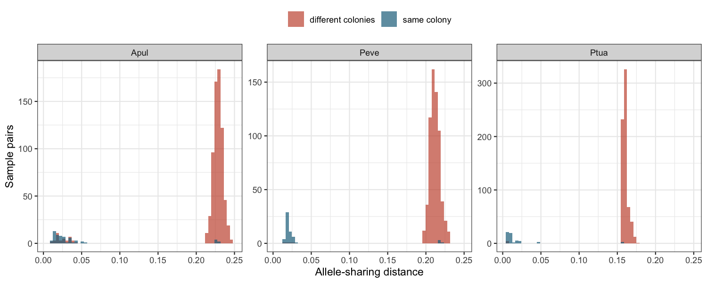
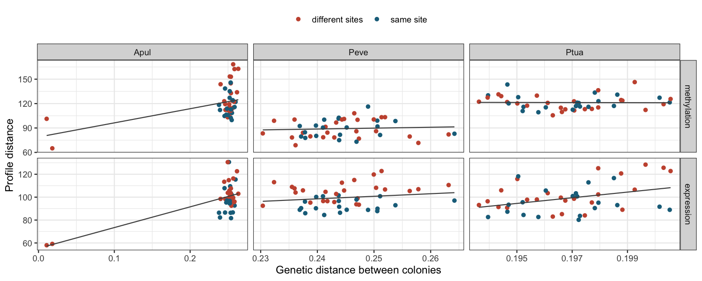

58-genotype-methylation
================
Steven Roberts
2026-11-23

- [1 Goal](#1-goal)
- [2 Genotypes](#2-genotypes)
  - [2.1 Sample identity check](#21-sample-identity-check)
  - [2.2 Colony genotypes](#22-colony-genotypes)
- [3 Does methylation similarity follow genetic
  relatedness?](#3-does-methylation-similarity-follow-genetic-relatedness)
  - [3.1 Sensitivity: one colony per
    genotype](#31-sensitivity-one-colony-per-genotype)
- [4 How much could C-\>T SNPs at CpGs inflate the colony
  signal?](#4-how-much-could-c-t-snps-at-cpgs-inflate-the-colony-signal)

# 1 Goal

`55` found that colony explains 26-40% of the variance in gene-body
methylation of methylated genes, while time explains little. That colony
signal could be:

- **genetic**: methylation differences follow DNA sequence differences
  between colonies, including C-\>T SNPs at CpGs, which bisulfite
  sequencing reads as loss of methylation, or
- **epigenetic**: stable colony-level differences beyond what genetic
  relatedness predicts.

This script:

1.  checks that each colony’s samples are genetically identical (a
    sample identity check),
2.  builds one genotype per colony,
3.  tests whether genetically closer colonies have more similar
    methylation (and expression) profiles,
4.  estimates how much C-\>T SNPs at CpGs could inflate the colony
    methylation signal, and
5.  asks whether colony methylation predicts colony physiology once
    genetic relatedness is accounted for.

Genotypes come from `58.0-colony-genotypes.sh`: SNPs called from RNA-seq
reads in 3,000 moderately expressed genes per species, read directly
from the BAMs on gannet. RNA-based calls cover only expressed exons and
are subject to allele-specific expression, so they are used for
relatedness among colonies, not for genome-wide masking.

With 10 colonies per species (45 colony pairs), the relatedness tests
have limited power.

``` r
knitr::opts_chunk$set(echo = TRUE, message = FALSE, warning = FALSE,
                      fig.width = 10, fig.height = 6, dpi = 150)
library(data.table)
library(ggplot2)
library(matrixStats)

out_dir <- "../output/58-genotype-methylation"
meth_dir <- "../output/55-variance-partitioning"
set.seed(58)
n_perm <- 9999
min_dp_sample <- 8     # reads for a per-sample genotype
min_dp_colony <- 15    # pooled reads for a colony genotype
species <- c("Apul", "Peve", "Ptua")
prefix <- c(Apul = "ACR", Peve = "POR", Ptua = "POC")

meta <- fread("../../master-molecular-metadata.csv")
meta[, sample := paste(colony, timepoint, sep = "-")]
setkey(meta, sample)
```

# 2 Genotypes

``` r
read_calls <- function(s) {
  vcf <- file.path(out_dir, paste0(s, "-snps.vcf.gz"))
  smp <- system2("bcftools", c("query", "-l", vcf), stdout = TRUE)
  q <- fread(cmd = paste("bcftools query -f '%CHROM\\t%POS\\t%REF\\t%ALT[\\t%AD]\\n'", vcf),
             header = FALSE, sep = "\t", colClasses = "character")  # keep "ref,alt" as text
  q[, V2 := as.integer(V2)]
  ad <- as.matrix(q[, -(1:4)])
  ref <- matrix(as.numeric(sub(",.*", "", ad)), nrow(ad))
  alt <- matrix(as.numeric(sub(".*,", "", ad)), nrow(ad))
  ref[is.na(ref)] <- 0; alt[is.na(alt)] <- 0
  colnames(ref) <- colnames(alt) <- smp
  list(sites = q[, 1:4][, setnames(.SD, c("chrom", "pos", "ref", "alt"))], ref = ref, alt = alt)
}
# dosage of the alternate allele from read counts: 0, 1 or 2, NA if too few reads
dosage <- function(ref, alt, min_dp) {
  dp <- ref + alt; f <- alt / dp
  d <- ifelse(f < 0.1, 0, ifelse(f > 0.9, 2, 1))
  d[dp < min_dp] <- NA
  d
}
# allele-sharing distance between columns, over sites called in both
ibs_dist <- function(d) {
  n <- ncol(d); out <- matrix(NA_real_, n, n, dimnames = list(colnames(d), colnames(d)))
  for (i in seq_len(n)) for (j in seq_len(n)) {
    ok <- !is.na(d[, i]) & !is.na(d[, j])
    out[i, j] <- mean(abs(d[ok, i] - d[ok, j])) / 2
  }
  out
}
calls <- setNames(lapply(species, read_calls), species)
knitr::kable(rbindlist(lapply(species, function(s)
  data.table(species = s, samples = ncol(calls[[s]]$ref), snps = nrow(calls[[s]]$ref)))),
  caption = "Biallelic SNPs (QUAL >= 30) in target genes")
```

| species | samples |   snps |
|:--------|--------:|-------:|
| Apul    |      40 | 421504 |
| Peve    |      38 | 256923 |
| Ptua    |      39 | 344642 |

Biallelic SNPs (QUAL \>= 30) in target genes

## 2.1 Sample identity check

Per-sample genotypes (at least 8 reads) at SNPs called in at least 80%
of samples. Samples from the same colony should be nearly identical; the
residual distance between them reflects genotyping error and
allele-specific expression.

``` r
id_check <- list(); sample_dist <- list()
for (s in species) {
  d <- dosage(calls[[s]]$ref, calls[[s]]$alt, min_dp_sample)
  d <- d[rowMeans(!is.na(d)) >= 0.8, ]
  D <- ibs_dist(d)
  sample_dist[[s]] <- D
  col <- sub("-TP[1-4]$", "", colnames(D))
  pairs <- data.table(which(upper.tri(D), arr.ind = TRUE))
  pairs[, `:=`(a = colnames(D)[row], b = colnames(D)[col], dist = D[cbind(row, col)])]
  pairs[, same_colony := sub("-TP[1-4]$", "", a) == sub("-TP[1-4]$", "", b)]
  # nearest other sample: is it from the same colony?
  nn <- rbindlist(lapply(colnames(D), function(x) {
    o <- D[x, setdiff(colnames(D), x)]
    data.table(sample = x, nearest = names(which.min(o)), nearest_dist = min(o),
               nearest_same_colony = sub("-TP[1-4]$", "", names(which.min(o))) ==
                 sub("-TP[1-4]$", "", x))
  }))
  id_check[[s]] <- list(pairs = pairs[, species := s], nn = nn[, species := s], sites = nrow(d))
}
pairs_all <- rbindlist(lapply(id_check, `[[`, "pairs"))
nn_all <- rbindlist(lapply(id_check, `[[`, "nn"))
knitr::kable(pairs_all[, .(pairs = .N, median = median(dist), max = max(dist), min = min(dist)),
                       by = .(species, same_colony)], digits = 3,
             caption = "Allele-sharing distance between samples")
```

| species | same_colony | pairs | median |   max |   min |
|:--------|:------------|------:|-------:|------:|------:|
| Apul    | TRUE        |    60 |  0.023 | 0.231 | 0.010 |
| Apul    | FALSE       |   720 |  0.228 | 0.246 | 0.012 |
| Peve    | TRUE        |    55 |  0.019 | 0.222 | 0.014 |
| Peve    | FALSE       |   648 |  0.211 | 0.232 | 0.016 |
| Ptua    | TRUE        |    57 |  0.009 | 0.158 | 0.006 |
| Ptua    | FALSE       |   684 |  0.159 | 0.176 | 0.007 |

Allele-sharing distance between samples

``` r
fwrite(nn_all, file.path(out_dir, "sample-identity-check.csv"))
knitr::kable(nn_all[nearest_same_colony == FALSE], digits = 3,
             caption = "Samples whose closest match is from another colony")
```

| sample      | nearest     | nearest_dist | nearest_same_colony | species |
|:------------|:------------|-------------:|:--------------------|:--------|
| ACR-145-TP1 | ACR-150-TP2 |        0.017 | FALSE               | Apul    |
| ACR-145-TP2 | ACR-237-TP3 |        0.016 | FALSE               | Apul    |
| ACR-145-TP3 | ACR-265-TP3 |        0.033 | FALSE               | Apul    |
| ACR-145-TP4 | ACR-265-TP3 |        0.026 | FALSE               | Apul    |
| ACR-150-TP2 | ACR-265-TP2 |        0.016 | FALSE               | Apul    |
| ACR-150-TP3 | ACR-237-TP3 |        0.012 | FALSE               | Apul    |
| ACR-150-TP4 | ACR-237-TP3 |        0.012 | FALSE               | Apul    |
| ACR-237-TP1 | ACR-150-TP4 |        0.017 | FALSE               | Apul    |
| ACR-237-TP3 | ACR-150-TP4 |        0.012 | FALSE               | Apul    |
| ACR-237-TP4 | ACR-150-TP4 |        0.019 | FALSE               | Apul    |
| ACR-265-TP1 | ACR-145-TP1 |        0.031 | FALSE               | Apul    |
| ACR-265-TP2 | ACR-150-TP2 |        0.016 | FALSE               | Apul    |
| ACR-265-TP3 | ACR-150-TP2 |        0.016 | FALSE               | Apul    |
| ACR-265-TP4 | ACR-145-TP1 |        0.025 | FALSE               | Apul    |
| POR-236-TP1 | POR-245-TP4 |        0.016 | FALSE               | Peve    |
| POR-245-TP3 | POR-236-TP1 |        0.024 | FALSE               | Peve    |
| POR-245-TP4 | POR-236-TP1 |        0.016 | FALSE               | Peve    |
| POC-53-TP1  | POC-57-TP4  |        0.007 | FALSE               | Ptua    |
| POC-53-TP2  | POC-57-TP4  |        0.007 | FALSE               | Ptua    |
| POC-53-TP4  | POC-57-TP4  |        0.008 | FALSE               | Ptua    |
| POC-57-TP4  | POC-53-TP2  |        0.007 | FALSE               | Ptua    |

Samples whose closest match is from another colony

Samples are grouped into genotypes by average-linkage clustering, cut at
an allele-sharing distance of 0.1. That cut sits midway between
same-colony distances (about 0.01-0.03) and different-colony distances
(about 0.15-0.25). A sample is flagged when it falls outside its
colony’s majority genotype. If a colony has no strict majority, its
samples whose genotype also contains another colony’s samples are
flagged. Flagged samples are left out of colony genotypes. They may be
mislabelled, so earlier analyses that assign them to their labelled
colony deserve a second look.

``` r
group_check <- rbindlist(lapply(species, function(s) {
  D <- sample_dist[[s]]
  g <- cutree(hclust(as.dist(D), "average"), h = 0.1)
  dt <- data.table(species = s, sample = names(g), colony = sub("-TP[1-4]$", "", names(g)),
                   genotype = paste0(s, "-G", g))
  dt[, n_colonies_in_genotype := uniqueN(colony), by = genotype]
  dt[, majority := {
    tb <- table(genotype); top <- names(tb)[tb > .N / 2]
    if (length(top)) top else NA_character_
  }, by = colony]
  dt[, flagged := ifelse(is.na(majority), n_colonies_in_genotype > 1, genotype != majority)]
  dt
}))
fwrite(group_check, file.path(out_dir, "sample-genotype-groups.csv"))
knitr::kable(group_check[, .(samples = .N, genotypes = uniqueN(genotype),
                             flagged = sum(flagged)), by = species])
```

| species | samples | genotypes | flagged |
|:--------|--------:|----------:|--------:|
| Apul    |      40 |         8 |       2 |
| Peve    |      38 |        10 |       2 |
| Ptua    |      39 |        10 |       1 |

``` r
knitr::kable(group_check[colony %in% colony[flagged] |
                           genotype %in% genotype[flagged | n_colonies_in_genotype > 1],
                         .(species, sample, genotype, flagged)][order(species, genotype, sample)],
             caption = "Colonies and genotypes involved in a mismatch")
```

| species | sample      | genotype | flagged |
|:--------|:------------|:---------|:--------|
| Apul    | ACR-145-TP1 | Apul-G2  | FALSE   |
| Apul    | ACR-145-TP3 | Apul-G2  | FALSE   |
| Apul    | ACR-145-TP4 | Apul-G2  | FALSE   |
| Apul    | ACR-150-TP2 | Apul-G2  | TRUE    |
| Apul    | ACR-265-TP1 | Apul-G2  | FALSE   |
| Apul    | ACR-265-TP2 | Apul-G2  | FALSE   |
| Apul    | ACR-265-TP3 | Apul-G2  | FALSE   |
| Apul    | ACR-265-TP4 | Apul-G2  | FALSE   |
| Apul    | ACR-145-TP2 | Apul-G3  | TRUE    |
| Apul    | ACR-150-TP1 | Apul-G3  | FALSE   |
| Apul    | ACR-150-TP3 | Apul-G3  | FALSE   |
| Apul    | ACR-150-TP4 | Apul-G3  | FALSE   |
| Apul    | ACR-237-TP1 | Apul-G3  | FALSE   |
| Apul    | ACR-237-TP2 | Apul-G3  | FALSE   |
| Apul    | ACR-237-TP3 | Apul-G3  | FALSE   |
| Apul    | ACR-237-TP4 | Apul-G3  | FALSE   |
| Peve    | POR-236-TP1 | Peve-G2  | FALSE   |
| Peve    | POR-236-TP2 | Peve-G2  | FALSE   |
| Peve    | POR-245-TP3 | Peve-G2  | TRUE    |
| Peve    | POR-245-TP4 | Peve-G2  | TRUE    |
| Peve    | POR-245-TP1 | Peve-G3  | FALSE   |
| Peve    | POR-245-TP2 | Peve-G3  | FALSE   |
| Ptua    | POC-57-TP1  | Ptua-G10 | FALSE   |
| Ptua    | POC-57-TP2  | Ptua-G10 | FALSE   |
| Ptua    | POC-57-TP3  | Ptua-G10 | FALSE   |
| Ptua    | POC-53-TP1  | Ptua-G9  | FALSE   |
| Ptua    | POC-53-TP2  | Ptua-G9  | FALSE   |
| Ptua    | POC-53-TP3  | Ptua-G9  | FALSE   |
| Ptua    | POC-53-TP4  | Ptua-G9  | FALSE   |
| Ptua    | POC-57-TP4  | Ptua-G9  | TRUE    |

Colonies and genotypes involved in a mismatch

For `55`-`57`: each sample’s genotype, named by the colonies that carry
it (clonemates share one name, such as `ACR-145+ACR-265`), and whether
the sample is excluded as a mismatch.

``` r
geno_names <- group_check[flagged == FALSE,
                          .(genotype_id = paste(sort(unique(colony)), collapse = "+")),
                          by = genotype]
sample_geno <- merge(group_check[, .(species, sample, colony, genotype, exclude = flagged)],
                     geno_names, by = "genotype", all.x = TRUE)
sample_geno[, genotype := NULL]
fwrite(sample_geno[order(sample)], file.path(out_dir, "sample-genotypes.csv"))
knitr::kable(unique(sample_geno[exclude == FALSE & grepl("\\+", genotype_id),
                                .(species, colony, genotype_id)]),
             caption = "Colonies that share a genotype")
```

| species | colony  | genotype_id     |
|:--------|:--------|:----------------|
| Apul    | ACR-145 | ACR-145+ACR-265 |
| Apul    | ACR-265 | ACR-145+ACR-265 |
| Apul    | ACR-150 | ACR-150+ACR-237 |
| Apul    | ACR-237 | ACR-150+ACR-237 |

Colonies that share a genotype

``` r
p_id <- ggplot(pairs_all, aes(dist, fill = same_colony)) +
  geom_histogram(bins = 60, position = "identity", alpha = 0.7) +
  facet_wrap(~ species, scales = "free_y") +
  scale_fill_manual(values = c(`TRUE` = "#1b6e8a", `FALSE` = "#c8553d"),
                    labels = c(`TRUE` = "same colony", `FALSE` = "different colonies")) +
  labs(x = "Allele-sharing distance", y = "Sample pairs", fill = NULL) +
  theme_bw() + theme(legend.position = "top")
ggsave(file.path(out_dir, "sample-identity.png"), p_id, width = 10, height = 4, dpi = 200)
p_id
```

<!-- -->

## 2.2 Colony genotypes

Reads are pooled across a colony’s samples (excluding flagged samples)
and a genotype is called from the pooled allele counts, with at least 15
reads. Sites must be called in every colony and be polymorphic among
them.

``` r
flagged <- group_check[flagged == TRUE, sample]
geno <- list(); gen_dist <- list()
for (s in species) {
  smp <- setdiff(colnames(calls[[s]]$ref), flagged)
  colony <- sub("-TP[1-4]$", "", smp)
  ref <- t(rowsum(t(calls[[s]]$ref[, smp]), colony))
  alt <- t(rowsum(t(calls[[s]]$alt[, smp]), colony))
  d <- dosage(ref, alt, min_dp_colony)
  keep <- rowSums(is.na(d)) == 0 & rowVars(d) > 0
  geno[[s]] <- list(d = d[keep, ], sites = calls[[s]]$sites[keep])
  gen_dist[[s]] <- ibs_dist(d[keep, ])
}
knitr::kable(rbindlist(lapply(species, function(s)
  data.table(species = s, colonies = ncol(geno[[s]]$d), polymorphic_sites = nrow(geno[[s]]$d),
             mean_pairwise_distance = mean(gen_dist[[s]][upper.tri(gen_dist[[s]])]),
             min_pairwise_distance = min(gen_dist[[s]][upper.tri(gen_dist[[s]])])))),
  digits = 3, caption = "Colony genotypes")
```

| species | colonies | polymorphic_sites | mean_pairwise_distance | min_pairwise_distance |
|:---|---:|---:|---:|---:|
| Apul | 10 | 84504 | 0.241 | 0.011 |
| Peve | 10 | 39026 | 0.245 | 0.230 |
| Ptua | 10 | 65138 | 0.197 | 0.194 |

Colony genotypes

Possible clones: colony pairs whose genetic distance is as small as that
between samples of the same colony.

``` r
clones <- rbindlist(lapply(species, function(s) {
  G <- gen_dist[[s]]; within <- id_check[[s]]$pairs[same_colony == TRUE, quantile(dist, 0.95)]
  idx <- which(upper.tri(G) & G <= within, arr.ind = TRUE)
  if (!nrow(idx)) return(NULL)
  data.table(species = s, colony_a = rownames(G)[idx[, 1]], colony_b = colnames(G)[idx[, 2]],
             distance = G[idx], same_colony_95pct = within)
}))
if (nrow(clones)) knitr::kable(clones, digits = 3) else cat("No colony pairs fall within same-colony distances.\n")
```

| species | colony_a | colony_b | distance | same_colony_95pct |
|:--------|:---------|:---------|---------:|------------------:|
| Apul    | ACR-150  | ACR-237  |    0.011 |             0.225 |
| Apul    | ACR-145  | ACR-265  |    0.018 |             0.225 |

# 3 Does methylation similarity follow genetic relatedness?

Colony profiles are colony means over timepoints, leaving out flagged
samples. Each feature is standardised across colonies so every gene
counts equally; colony distance is Euclidean distance between these
profiles.

- **Methylation**: gene-body methylation of genes with at least 5% mean
  methylation and a value in every sample (from `55.1`).
- **Expression**: VST expression of the 5,000 most variable genes.
- **Physiology**: the 13 traits from `57` (log10 where strictly
  positive).

Mantel tests permute colony labels (9999 permutations). Partial tests
add a same-site / different-site matrix, because colonies at one site
share both ancestry and environment.

``` r
colony_profile <- function(m) {
  m <- m[, !colnames(m) %in% flagged, drop = FALSE]   # same samples as the genotypes
  colony <- sub("-TP[1-4]$", "", colnames(m))
  cm <- t(rowsum(t(m), colony, na.rm = TRUE) / as.vector(table(colony)))
  cm <- cm[rowVars(cm) > 0, , drop = FALSE]
  (cm - rowMeans(cm)) / rowSds(cm)
}
profile_dist <- function(z) as.matrix(dist(t(z)))

vst_counts <- function(f) {
  m <- fread(f); x <- as.matrix(m[, -1]); rownames(x) <- m[[1]]
  s <- regmatches(colnames(x), regexpr("(ACR|POR|POC)-[0-9]+-TP[1-4]", colnames(x)))
  x <- t(rowsum(t(round(x)), s))
  x <- x[rowSums(x >= 10) >= ncol(x) / 4, ]
  suppressMessages({
    dds <- DESeq2::DESeqDataSetFromMatrix(x, data.frame(row.names = colnames(x)), ~ 1)
    dds <- DESeq2::estimateSizeFactors(dds, type = "poscounts")
    SummarizedExperiment::assay(DESeq2::varianceStabilizingTransformation(dds, blind = TRUE))
  })
}
counts_f <- c(Apul = "../../D-Apul/output/02.20-D-Apul-RNAseq-alignment-HiSat2/apul-gene_count_matrix.csv",
              Peve = "../../E-Peve/output/02.20-E-Peve-RNAseq-alignment-HiSat2/peve-gene_count_matrix.csv",
              Ptua = "../../F-Ptua/output/02.20-F-Ptua-RNAseq-alignment-HiSat2/ptua-gene_count_matrix.csv")

traits <- c("cre.umol.mgprot", "Host_AFDW.mg.cm2", "Sym_AFDW.mg.cm2", "chla.ug.cm2",
            "chlc2.ug.cm2", "prot_ug.cm2", "cells.cm2", "Am", "AQY", "Rd", "Ik", "Ic",
            "calc.umol.cm2.hr")
phys <- fread("../data/phys_master_timeseries.csv")
phys[, sample := paste(colony_id_corr, sub("timepoint", "TP", timepoint), sep = "-")]
phys <- unique(phys, by = "sample")
for (tr in traits) if (all(phys[[tr]] > 0, na.rm = TRUE)) set(phys, j = tr, value = log10(phys[[tr]]))

dists <- list()
for (s in species) {
  cols <- colnames(gen_dist[[s]])
  M <- fread(file.path(meth_dir, paste0(s, "-gene-body-methylation.csv.gz")))
  Mm <- as.matrix(M[, -1]); rownames(Mm) <- M$gene_id
  Mm <- Mm[rowSums(is.na(Mm)) == 0 & rowMeans(Mm) >= 5, ]
  E <- vst_counts(counts_f[[s]]); E <- E[order(rowVars(E), decreasing = TRUE)[1:5000], ]
  p <- phys[startsWith(sample, prefix[[s]])]
  P <- t(as.matrix(p[, ..traits])); colnames(P) <- p$sample
  P <- (P - rowMeans(P, na.rm = TRUE)) / rowSds(P, na.rm = TRUE)
  site <- unique(meta[startsWith(colony, prefix[[s]]), .(colony, site)])
  site <- setNames(site$site, site$colony)[cols]
  dists[[s]] <- list(
    genetic = gen_dist[[s]][cols, cols],
    methylation = profile_dist(colony_profile(Mm))[cols, cols],
    expression = profile_dist(colony_profile(E))[cols, cols],
    physiology = profile_dist(colony_profile(P))[cols, cols],
    different_site = outer(site, site, "!=") * 1)
}
```

``` r
# Pearson Mantel r and permutation p; partial Mantel uses residuals on z
lower <- function(m) m[lower.tri(m)]
mantel <- function(x, y, z = NULL, n = n_perm) {
  res <- function(a, b) if (is.null(b)) a else resid(lm(a ~ b))
  stat <- function(xx) cor(res(lower(xx), if (is.null(z)) NULL else lower(z)),
                           res(lower(y), if (is.null(z)) NULL else lower(z)))
  obs <- stat(x)
  null <- replicate(n, { o <- sample(nrow(x)); stat(x[o, o]) })
  c(r = obs, p = (1 + sum(null >= obs)) / (n + 1))
}
tests <- list(
  c("methylation", "genetic", NA), c("methylation", "genetic", "different_site"),
  c("expression", "genetic", NA), c("expression", "genetic", "different_site"),
  c("methylation", "expression", NA), c("methylation", "expression", "genetic"),
  c("physiology", "genetic", NA),
  c("physiology", "methylation", NA), c("physiology", "methylation", "genetic"),
  c("physiology", "expression", NA), c("physiology", "expression", "genetic"))
mantel_res <- rbindlist(lapply(species, function(s) rbindlist(lapply(tests, function(t) {
  d <- dists[[s]]
  m <- mantel(d[[t[1]]], d[[t[2]]], if (is.na(t[3])) NULL else d[[t[3]]])
  data.table(species = s, x = t[1], y = t[2], controlling_for = ifelse(is.na(t[3]), "", t[3]),
             mantel_r = m[["r"]], p = m[["p"]])
}))))
fwrite(mantel_res, file.path(out_dir, "mantel-tests.csv"))
knitr::kable(dcast(mantel_res, x + y + controlling_for ~ species, value.var = c("mantel_r", "p")),
             digits = 3)
```

| x | y | controlling_for | mantel_r_Apul | mantel_r_Peve | mantel_r_Ptua | p_Apul | p_Peve | p_Ptua |
|:---|:---|:---|---:|---:|---:|---:|---:|---:|
| expression | genetic |  | 0.643 | 0.178 | 0.359 | 0.000 | 0.132 | 0.027 |
| expression | genetic | different_site | 0.679 | 0.253 | 0.372 | 0.000 | 0.063 | 0.021 |
| methylation | expression |  | 0.141 | 0.199 | 0.114 | 0.234 | 0.155 | 0.310 |
| methylation | expression | genetic | -0.201 | 0.190 | 0.126 | 0.784 | 0.158 | 0.291 |
| methylation | genetic |  | 0.436 | 0.073 | -0.012 | 0.000 | 0.349 | 0.521 |
| methylation | genetic | different_site | 0.494 | 0.073 | -0.012 | 0.000 | 0.347 | 0.519 |
| physiology | expression |  | 0.187 | 0.280 | 0.110 | 0.179 | 0.045 | 0.328 |
| physiology | expression | genetic | 0.221 | 0.309 | 0.130 | 0.174 | 0.035 | 0.310 |
| physiology | genetic |  | 0.027 | -0.123 | -0.031 | 0.439 | 0.776 | 0.565 |
| physiology | methylation |  | 0.032 | 0.366 | -0.133 | 0.427 | 0.010 | 0.675 |
| physiology | methylation | genetic | 0.023 | 0.379 | -0.133 | 0.454 | 0.007 | 0.678 |

Pooled across species (Fisher’s method on the one-sided p-values):

``` r
pooled <- mantel_res[, .(mean_r = mean(mantel_r),
                         fisher_p = pchisq(-2 * sum(log(p)), 2 * .N, lower.tail = FALSE)),
                     by = .(x, y, controlling_for)]
knitr::kable(pooled, digits = 4)
```

| x           | y           | controlling_for |  mean_r | fisher_p |
|:------------|:------------|:----------------|--------:|---------:|
| methylation | genetic     |                 |  0.1657 |   0.0041 |
| methylation | genetic     | different_site  |  0.1850 |   0.0023 |
| expression  | genetic     |                 |  0.3931 |   0.0001 |
| expression  | genetic     | different_site  |  0.4345 |   0.0000 |
| methylation | expression  |                 |  0.1513 |   0.1755 |
| methylation | expression  | genetic         |  0.0381 |   0.3542 |
| physiology  | genetic     |                 | -0.0426 |   0.7707 |
| physiology  | methylation |                 |  0.0883 |   0.0695 |
| physiology  | methylation | genetic         |  0.0894 |   0.0565 |
| physiology  | expression  |                 |  0.1922 |   0.0651 |
| physiology  | expression  | genetic         |  0.2201 |   0.0506 |

## 3.1 Sensitivity: one colony per genotype

Colony pairs that share a genotype (above) give near-zero genetic
distance and, if the genotype drives the profiles, near-zero profile
distance too, so a few pairs can carry a Mantel test. Here the second
colony of each such pair is dropped and the tests are repeated for the
affected species.

``` r
drop <- if (nrow(clones)) clones[, .(colony = unique(colony_b)), by = species] else
  data.table(species = character(), colony = character())
mantel_nc <- rbindlist(lapply(unique(drop$species), function(s) {
  keep <- setdiff(colnames(dists[[s]]$genetic), drop[species == s, colony])
  d <- lapply(dists[[s]], function(m) m[keep, keep])
  rbindlist(lapply(tests, function(t) {
    m <- mantel(d[[t[1]]], d[[t[2]]], if (is.na(t[3])) NULL else d[[t[3]]])
    data.table(species = s, colonies = length(keep), x = t[1], y = t[2],
               controlling_for = ifelse(is.na(t[3]), "", t[3]),
               mantel_r = m[["r"]], p = m[["p"]])
  }))
}))
if (nrow(mantel_nc)) {
  fwrite(mantel_nc, file.path(out_dir, "mantel-tests-one-colony-per-genotype.csv"))
  knitr::kable(mantel_nc, digits = 3)
}
```

| species | colonies | x           | y           | controlling_for | mantel_r |     p |
|:--------|---------:|:------------|:------------|:----------------|---------:|------:|
| Apul    |        8 | methylation | genetic     |                 |    0.275 | 0.096 |
| Apul    |        8 | methylation | genetic     | different_site  |    0.247 | 0.142 |
| Apul    |        8 | expression  | genetic     |                 |    0.220 | 0.171 |
| Apul    |        8 | expression  | genetic     | different_site  |    0.206 | 0.204 |
| Apul    |        8 | methylation | expression  |                 |   -0.134 | 0.581 |
| Apul    |        8 | methylation | expression  | genetic         |   -0.208 | 0.724 |
| Apul    |        8 | physiology  | genetic     |                 |   -0.344 | 0.949 |
| Apul    |        8 | physiology  | methylation |                 |    0.032 | 0.482 |
| Apul    |        8 | physiology  | methylation | genetic         |    0.140 | 0.320 |
| Apul    |        8 | physiology  | expression  |                 |    0.168 | 0.299 |
| Apul    |        8 | physiology  | expression  | genetic         |    0.266 | 0.197 |

``` r
pl <- rbindlist(lapply(species, function(s) {
  d <- dists[[s]]
  data.table(species = s, genetic = lower(d$genetic), methylation = lower(d$methylation),
             expression = lower(d$expression), same_site = lower(d$different_site) == 0)
}))
pl <- melt(pl, id.vars = c("species", "genetic", "same_site"), variable.name = "layer",
           value.name = "profile_distance")
p_m <- ggplot(pl, aes(genetic, profile_distance, colour = same_site)) +
  geom_point() + geom_smooth(method = "lm", se = FALSE, colour = "grey30", linewidth = 0.5) +
  facet_grid(layer ~ species, scales = "free") +
  scale_colour_manual(values = c(`TRUE` = "#1b6e8a", `FALSE` = "#c8553d"),
                      labels = c(`TRUE` = "same site", `FALSE` = "different sites")) +
  labs(x = "Genetic distance between colonies", y = "Profile distance", colour = NULL) +
  theme_bw() + theme(legend.position = "top")
ggsave(file.path(out_dir, "distance-vs-genetic.png"), p_m, width = 10, height = 6, dpi = 200)
p_m
```

<!-- -->

# 4 How much could C-\>T SNPs at CpGs inflate the colony signal?

A C-\>T SNP at the C of a CpG, or G-\>A at the G on the other strand,
removes the CpG in carriers, and bisulfite sequencing reads it as
unmethylated. Such sites look like strong colony effects.

Using the CpGs that were modelled in `55` (called in every sample), this
compares the colony variance fraction of CpGs that coincide with a C-\>T
/ G-\>A SNP found among the colonies against all other CpGs inside the
same target genes. Only CpGs in the 3,000 genotyped genes can be
checked.

``` r
cpg_snp <- rbindlist(lapply(species, function(s) {
  f <- file.path(meth_dir, paste0(s, "-CpG-complete.csv.gz"))
  if (!file.exists(f)) return(NULL)
  vp <- fread(file.path(meth_dir, "variance-fractions-per-feature.csv.gz"))[species == s & layer == "mCpG"]
  # ids look like CpG_<scaffold>_<pos>
  vp[, c("chrom", "pos") := .(sub("^CpG_(.*)_[0-9]+$", "\\1", feature),
                              as.integer(sub(".*_", "", feature)))]
  sites <- calls[[s]]$sites
  ct <- sites[(ref == "C" & alt == "T") | (ref == "G" & alt == "A")]
  # C of a CpG is at pos; G of the CpG is pos + 1
  ct_pos <- unique(rbind(ct[ref == "C", .(chrom, cpg = pos)], ct[ref == "G", .(chrom, cpg = pos - 1L)]))
  targets <- fread(file.path(out_dir, paste0(s, "-targets.bed")), col.names = c("chrom", "start", "end"))
  setkey(targets, chrom, start, end)
  vp[, start := pos - 1L][, end := pos]
  in_t <- foverlaps(vp[, .(feature, chrom, start, end)], targets, nomatch = 0L)$feature
  v <- vp[feature %in% in_t]
  v[, snp := paste(chrom, pos) %in% ct_pos[, paste(chrom, cpg)]]
  v[, .(species = s, cpgs = .N, colony = mean(colony), timepoint = mean(timepoint),
        residual = mean(residual)), by = snp]
}))
knitr::kable(cpg_snp, digits = 3,
             caption = "Modelled CpGs inside genotyped genes, by overlap with a C->T / G->A SNP")
```

| snp   | species | cpgs | colony | timepoint | residual |
|:------|:--------|-----:|-------:|----------:|---------:|
| FALSE | Apul    | 1257 |  0.245 |     0.022 |    0.682 |
| TRUE  | Apul    |    3 |  0.497 |     0.009 |    0.481 |
| FALSE | Peve    |  796 |  0.285 |     0.020 |    0.638 |
| TRUE  | Peve    |    1 |  0.799 |     0.000 |    0.201 |
| FALSE | Ptua    | 2168 |  0.107 |     0.020 |    0.816 |
| TRUE  | Ptua    |    2 |  0.000 |     0.045 |    0.852 |

Modelled CpGs inside genotyped genes, by overlap with a C-\>T / G-\>A
SNP

``` r
sessionInfo()
```

    ## R version 4.5.1 (2025-06-13)
    ## Platform: aarch64-apple-darwin20
    ## Running under: macOS Sequoia 15.6.1
    ## 
    ## Matrix products: default
    ## BLAS:   /Library/Frameworks/R.framework/Versions/4.5-arm64/Resources/lib/libRblas.0.dylib 
    ## LAPACK: /Library/Frameworks/R.framework/Versions/4.5-arm64/Resources/lib/libRlapack.dylib;  LAPACK version 3.12.1
    ## 
    ## locale:
    ## [1] en_US/en_US/en_US/C/en_US/en_US
    ## 
    ## time zone: America/Los_Angeles
    ## tzcode source: internal
    ## 
    ## attached base packages:
    ## [1] stats     graphics  grDevices utils     datasets  methods   base     
    ## 
    ## other attached packages:
    ## [1] matrixStats_1.5.0 ggplot2_4.0.1     data.table_1.17.8
    ## 
    ## loaded via a namespace (and not attached):
    ##  [1] rappdirs_0.3.3              generics_0.1.4             
    ##  [3] SparseArray_1.10.10         DESeq2_1.50.2              
    ##  [5] lattice_0.22-7              digest_0.6.39              
    ##  [7] magrittr_2.0.4              evaluate_1.0.5             
    ##  [9] grid_4.5.1                  RColorBrewer_1.1-3         
    ## [11] fastmap_1.2.0               Matrix_1.7-4               
    ## [13] R.oo_1.27.1                 jsonlite_2.0.0             
    ## [15] R.utils_2.13.0              mgcv_1.9-4                 
    ## [17] scales_1.4.0                coro_1.1.0                 
    ## [19] codetools_0.2-20            httr2_1.2.1                
    ## [21] textshaping_1.0.4           abind_1.4-8                
    ## [23] cli_3.6.5                   rlang_1.3.0                
    ## [25] XVector_0.50.0              R.methodsS3_1.8.2          
    ## [27] Biobase_2.70.0              splines_4.5.1              
    ## [29] DelayedArray_0.36.1         withr_3.0.2                
    ## [31] yaml_2.3.10                 S4Arrays_1.10.1            
    ## [33] tools_4.5.1                 parallel_4.5.1             
    ## [35] BiocParallel_1.44.0         dplyr_1.2.1                
    ## [37] locfit_1.5-9.12             SummarizedExperiment_1.40.0
    ## [39] BiocGenerics_0.56.0         curl_7.0.0                 
    ## [41] vctrs_0.7.3                 R6_2.6.1                   
    ## [43] stats4_4.5.1                lifecycle_1.0.5            
    ## [45] Seqinfo_1.0.0               S4Vectors_0.48.0           
    ## [47] IRanges_2.44.0              ragg_1.5.0                 
    ## [49] pkgconfig_2.0.3             pillar_1.11.1              
    ## [51] gtable_0.3.6                glue_1.8.0                 
    ## [53] Rcpp_1.1.2                  systemfonts_1.3.1          
    ## [55] xfun_0.54                   tibble_3.3.0               
    ## [57] GenomicRanges_1.62.1        tidyselect_1.2.1           
    ## [59] MatrixGenerics_1.22.0       knitr_1.50                 
    ## [61] farver_2.1.2                nlme_3.1-168               
    ## [63] htmltools_0.5.8.1           rmarkdown_2.30             
    ## [65] labeling_0.4.3              ellmer_0.4.0               
    ## [67] compiler_4.5.1              S7_0.2.1
