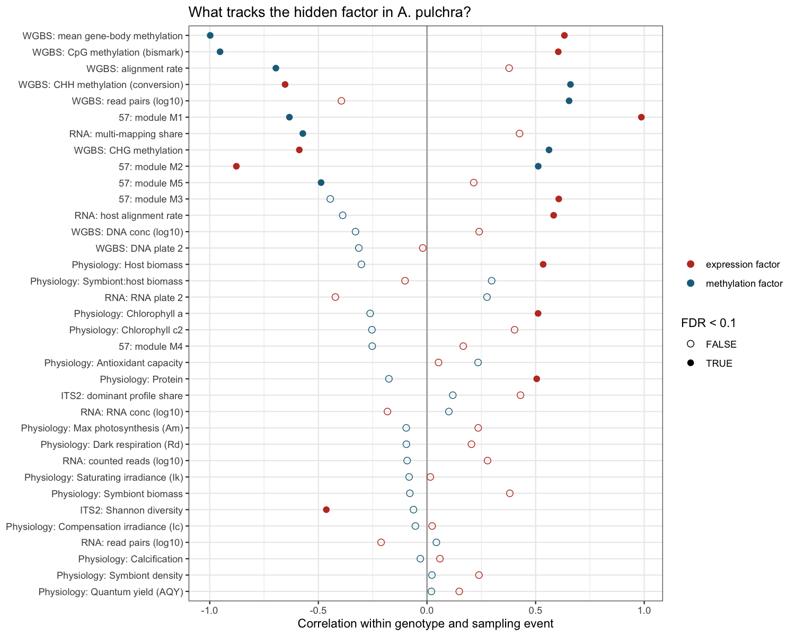

59-hidden-factor
================
Steven Roberts
2026-11-24

- [1 Goal](#1-goal)
- [2 Inputs](#2-inputs)
- [3 The factors](#3-the-factors)
  - [3.1 Which layer’s factor removes the
    excess?](#31-which-layers-factor-removes-the-excess)
- [4 Candidate explanations](#4-candidate-explanations)
  - [4.1 Correlation with the factors](#41-correlation-with-the-factors)
  - [4.2 Does a measured candidate reproduce the factor’s
    effect?](#42-does-a-measured-candidate-reproduce-the-factors-effect)
- [5 Which genes carry the factor?](#5-which-genes-carry-the-factor)

# 1 Goal

In `56.1-within-colony-adjusted`, *A. pulchra* had about 300 more genes
than expected whose methylation and expression co-vary within genotypes.
Removing one hidden factor per layer took that excess to zero. This
script asks what that factor is.

- **Technical**: sequencing depth, alignment rate, bisulfite conversion,
  nucleic-acid yield, plate. If so, the within-genotype coupling is an
  artifact.
- **Biological**: symbiont content, tissue composition (host and
  symbiont biomass, protein), physiology, or the tissue-state modules M1
  and M2 from `57`.

Thermal history is measured per site and timepoint, so it is absorbed by
the `site:timepoint` term and cannot explain a factor that lies within
it.

The factor scores are residuals on `genotype + site:timepoint`. Every
candidate is residualised on the same design before correlating, so a
match means the candidate varies with the factor *within genotype and
sampling event*, not just between colonies or seasons.

Sample identity follows `58`: the five mismatched samples are excluded
and clonemates share one genotype.

``` r
knitr::opts_chunk$set(echo = TRUE, message = FALSE, warning = FALSE,
                      fig.width = 10, fig.height = 6, dpi = 150)
library(data.table)
library(DESeq2)
library(ggplot2)
library(matrixStats)

out_dir  <- "../output/59-hidden-factor"
meth_dir <- "../output/55-variance-partitioning"
dir.create(out_dir, showWarnings = FALSE, recursive = TRUE)
n_perm <- 500
set.seed(59)
```

# 2 Inputs

Same genes, samples and helpers as `56.1`, Apul only.

``` r
meta <- fread("../../master-molecular-metadata.csv")
meta[, sample := paste(colony, timepoint, sep = "-")]
meta[, st := paste(site, timepoint, sep = ":")]
geno <- fread("../output/58-genotype-methylation/sample-genotypes.csv")
meta <- meta[!sample %in% geno[exclude == TRUE, sample]]
meta[, colony_label := colony]
meta[unique(geno[exclude == FALSE, .(colony, genotype_id)]), colony := i.genotype_id, on = "colony"]
setkey(meta, sample)

canon <- function(x) {
  hit <- grepl("(ACR|POR|POC)-[0-9]+[-_]TP[1-4]", x)
  out <- rep(NA_character_, length(x))
  out[hit] <- sub("_", "-", regmatches(x, regexpr("(ACR|POR|POC)-[0-9]+[-_]TP[1-4]", x)))
  out
}
as_matrix <- function(dt) {
  keep <- names(dt)[-1]; s <- canon(keep)
  keep <- keep[!is.na(s)]; s <- s[!is.na(s)]
  m <- as.matrix(dt[, ..keep]); storage.mode(m) <- "double"
  if (anyDuplicated(s)) m <- t(rowsum(t(m), s)) else colnames(m) <- s
  rownames(m) <- dt[[1]]
  m <- m[, colnames(m) %in% meta$sample, drop = FALSE]
  m[, sort(colnames(m)), drop = FALSE]
}
vst_counts <- function(m, min_count = 10) {
  m <- round(m)
  m <- m[rowSums(m >= min_count) >= ceiling(ncol(m) / 4), , drop = FALSE]
  dds <- DESeqDataSetFromMatrix(m, data.frame(row.names = colnames(m)), ~ 1)
  dds <- estimateSizeFactors(dds, type = "poscounts")
  assay(varianceStabilizingTransformation(dds, blind = TRUE))
}
resid_rows <- function(Y, X) {
  q <- qr(X); Q <- qr.Q(q)[, seq_len(q$rank), drop = FALSE]
  Y - (Y %*% Q) %*% t(Q)
}
rowcor <- function(A, B) rowSums(A * B) / sqrt(rowSums(A^2) * rowSums(B^2))
p_from_r <- function(r, df) 2 * pt(-abs(r * sqrt(df / (1 - r^2))), df)
shuffle_within <- function(groups) {
  idx <- seq_along(groups)
  for (g in split(idx, groups)) if (length(g) > 1) idx[g] <- g[sample.int(length(g))]
  idx
}
top_scores <- function(Y, X, k) if (k == 0) NULL else svd(resid_rows(Y, X), nu = 0, nv = k)$v

counts <- fread("../../D-Apul/output/02.20-D-Apul-RNAseq-alignment-HiSat2/apul-gene_count_matrix.csv")
raw <- as_matrix(counts)
E <- vst_counts(raw)
M <- as_matrix(fread(file.path(meth_dir, "Apul-gene-body-methylation.csv.gz")))
smp <- intersect(colnames(E), colnames(M))
M <- M[intersect(rownames(E), rownames(M)), smp, drop = FALSE]
M <- M[rowSums(is.na(M)) == 0 & rowVars(M) > 0, , drop = FALSE]
E <- E[rownames(M), smp, drop = FALSE]
md <- meta[smp]
X0 <- model.matrix(~ colony + st, md)
c(genes = nrow(M), samples = length(smp), design_rank = qr(X0)$rank)
```

    ##       genes     samples design_rank 
    ##       13180          37          15

# 3 The factors

The first component of each layer’s residuals, as used at *k* = 1 in
`56.1`.

``` r
fac <- data.table(sample = smp,
                  expr_factor = top_scores(E, X0, 1)[, 1],
                  meth_factor = top_scores(M, X0, 1)[, 1])
pct <- function(Y) { R <- resid_rows(Y, X0); d <- svd(R, nu = 0, nv = 0)$d; 100 * d[1]^2 / sum(d^2) }
data.table(layer = c("expression", "methylation"),
           pct_resid_var = c(pct(E), pct(M)),
           r_between_layers = cor(fac$expr_factor, fac$meth_factor))
```

    ##          layer pct_resid_var r_between_layers
    ##         <char>         <num>            <num>
    ## 1:  expression      22.54572       -0.6276445
    ## 2: methylation      43.38508       -0.6276445

## 3.1 Which layer’s factor removes the excess?

The within-genotype test from `56.1`, with no factor, one layer’s factor
only, or both. The null shuffles methylation samples within genotype and
recomputes the methylation factor each time.

``` r
run_test <- function(E, M, md, extra = NULL, use_e = FALSE, use_m = FALSE, n_perm = 500) {
  X0 <- cbind(model.matrix(~ colony + st, md), extra)
  VE <- if (use_e) top_scores(E, X0, 1)
  fit <- function(M) {
    X <- cbind(X0, VE, if (use_m) top_scores(M, X0, 1))
    df <- nrow(md) - qr(X)$rank - 1
    sum(p_from_r(rowcor(resid_rows(M, X), resid_rows(E, X)), df) < 0.01)
  }
  obs <- fit(M)
  null <- vapply(seq_len(n_perm), function(b) fit(M[, shuffle_within(md$colony), drop = FALSE]), numeric(1))
  data.table(samples = nrow(md), n_p01 = obs, null_n_p01 = mean(null),
             excess = obs - mean(null), perm_p = (1 + sum(null >= obs)) / (n_perm + 1))
}
layer_tests <- rbindlist(list(
  cbind(removed = "none",                 run_test(E, M, md)),
  cbind(removed = "expression factor",    run_test(E, M, md, use_e = TRUE)),
  cbind(removed = "methylation factor",   run_test(E, M, md, use_m = TRUE)),
  cbind(removed = "both",                 run_test(E, M, md, use_e = TRUE, use_m = TRUE))))
fwrite(layer_tests, file.path(out_dir, "excess-by-layer-factor.csv"))
knitr::kable(layer_tests, digits = 3)
```

| removed            | samples | n_p01 | null_n_p01 |  excess | perm_p |
|:-------------------|--------:|------:|-----------:|--------:|-------:|
| none               |      37 |   443 |    133.140 | 309.860 |  0.002 |
| expression factor  |      37 |   240 |    133.388 | 106.612 |  0.014 |
| methylation factor |      37 |   133 |    128.052 |   4.948 |  0.365 |
| both               |      37 |   130 |    129.698 |   0.302 |  0.505 |

# 4 Candidate explanations

``` r
cand <- data.table(sample = smp)
add <- function(dt, label, group) {
  dt <- unique(dt, by = "sample")
  v <- setdiff(names(dt), "sample")
  for (x in v) cand[dt, (paste0(group, ": ", x)) := get(paste0("i.", x)), on = "sample"]
}

# RNA-seq: depth, host alignment rate (unaligned reads are largely symbiont), counted reads
hs <- fread("../../D-Apul/output/02.20-D-Apul-RNAseq-alignment-HiSat2/multiqc_data/multiqc_bowtie2.txt")
hs[, sample := sub("_hisat2", "", Sample)]
add(hs[, .(sample, `read pairs (log10)` = log10(total_reads),
           `host alignment rate` = overall_alignment_rate,
           `multi-mapping share` = paired_aligned_multi / total_reads)], "RNA", "RNA")
add(data.table(sample = colnames(raw), `counted reads (log10)` = log10(colSums(raw))), "RNA", "RNA")

# RNA extraction: yield, plate
rm_ <- fread("../data/rna_metadata.csv")
rm_[, sample := paste(ColonyID, Timepoint, sep = "-")]
add(rm_[, .(sample, `RNA conc (log10)` = log10(`Conc-ng.uL`), `RNA plate 2` = as.numeric(Plate == 2))], "RNA", "RNA")

# WGBS: depth, alignment, CpG level, non-CpG methylation (conversion), DNA yield
bm <- fread("../../D-Apul/output/02.20-D-Apul-WGBS-alignment-SLURM_array-bismark/multiqc_data/multiqc_bismark_alignment.txt")
bm[, well := regmatches(Sample, regexpr("[0-9][A-H][0-9]+(?=_R1)", Sample, perl = TRUE))]
dm <- fread("../data/e5_DNA_Azenta_metadata.csv")
dm <- dm[`Species/Strain*` == "Acropora pulchra",
         .(well = `Azenta sample name`, sample = paste(`Colony ID`, Timepoint, sep = "-"),
           dna_conc = `Conc (ng/µL)`, plate = Plate)]
bm <- merge(bm, dm, by = "well")
add(bm[, .(sample, `read pairs (log10)` = log10(total_reads),
           `alignment rate` = percent_aligned,
           `CpG methylation (bismark)` = 100 * meth_cpg / (meth_cpg + unmeth_cpg),
           `CHH methylation (conversion)` = 100 * meth_chh / (meth_chh + unmeth_chh),
           `CHG methylation` = 100 * meth_chg / (meth_chg + unmeth_chg),
           `DNA conc (log10)` = log10(dna_conc), `DNA plate 2` = as.numeric(plate == 2))], "WGBS", "WGBS")
add(data.table(sample = smp, `mean gene-body methylation` = colMeans(M)), "WGBS", "WGBS")

# Physiology: the 13 traits from 57, log10 where positive
traits <- c(cre.umol.mgprot = "Antioxidant capacity", Host_AFDW.mg.cm2 = "Host biomass",
            Sym_AFDW.mg.cm2 = "Symbiont biomass", chla.ug.cm2 = "Chlorophyll a",
            chlc2.ug.cm2 = "Chlorophyll c2", prot_ug.cm2 = "Protein",
            cells.cm2 = "Symbiont density", Am = "Max photosynthesis (Am)",
            AQY = "Quantum yield (AQY)", Rd = "Dark respiration (Rd)",
            Ik = "Saturating irradiance (Ik)", Ic = "Compensation irradiance (Ic)",
            calc.umol.cm2.hr = "Calcification", Ratio_AFDW.mg.cm2 = "Symbiont:host biomass")
phys <- fread("../data/phys_master_timeseries.csv")
phys[, sample := paste(colony_id_corr, sub("timepoint", "TP", timepoint), sep = "-")]
phys <- unique(phys, by = "sample")
for (tr in names(traits))
  if (all(phys[[tr]] > 0, na.rm = TRUE)) set(phys, j = tr, value = log10(phys[[tr]]))
pt_ <- phys[, c("sample", names(traits)), with = FALSE]; setnames(pt_, names(traits), traits)
add(pt_, "Physiology", "Physiology")

# Symbiont community (ITS2): share of the dominant profile, Shannon diversity
its <- fread("../data/ITS2_rel_abund_matrix.csv")
its <- its[grepl("^ACR", colony_id_corr)]
its[, sample := paste(colony_id_corr, sub("timepoint", "TP", timepoint), sep = "-")]
pc <- setdiff(names(its)[11:ncol(its)], "sample")
A <- as.matrix(its[, ..pc]); A <- A / rowSums(A)
add(data.table(sample = its$sample, `dominant profile share` = apply(A, 1, max),
               `Shannon diversity` = -rowSums(ifelse(A > 0, A * log(A), 0))), "ITS2", "ITS2")

# Tissue-state modules from 57 (eigengene = PC1 of the module's scaled genes)
mods <- fread("../output/57-expression-physiology-thermal/gene-module-assignments.csv.gz")[species == "Apul"]
Efull <- vst_counts(raw)[, smp]
eig <- function(g) { Z <- t(scale(t(Efull[intersect(g, rownames(Efull)), ]))); v <- svd(Z, nu = 0, nv = 1)$v[, 1]
  v * sign(cor(v, colMeans(Z))) }
top_mods <- mods[module != "M0", .N, by = module][order(-N)][1:5, module]
add(as.data.table(c(list(sample = smp), setNames(lapply(top_mods, function(m) eig(mods[module == m, gene])),
                                              paste("module", top_mods)))), "57", "57")

data.table(candidate = names(cand)[-1], n = sapply(cand[, -1], function(x) sum(!is.na(x))))
```

    ##                                    candidate     n
    ##                                       <char> <int>
    ##  1:                  RNA: read pairs (log10)    37
    ##  2:                 RNA: host alignment rate    37
    ##  3:                 RNA: multi-mapping share    37
    ##  4:               RNA: counted reads (log10)    37
    ##  5:                    RNA: RNA conc (log10)    37
    ##  6:                         RNA: RNA plate 2    37
    ##  7:                 WGBS: read pairs (log10)    37
    ##  8:                     WGBS: alignment rate    37
    ##  9:          WGBS: CpG methylation (bismark)    37
    ## 10:       WGBS: CHH methylation (conversion)    37
    ## 11:                    WGBS: CHG methylation    37
    ## 12:                   WGBS: DNA conc (log10)    37
    ## 13:                        WGBS: DNA plate 2    37
    ## 14:         WGBS: mean gene-body methylation    37
    ## 15:         Physiology: Antioxidant capacity    34
    ## 16:                 Physiology: Host biomass    36
    ## 17:             Physiology: Symbiont biomass    36
    ## 18:                Physiology: Chlorophyll a    36
    ## 19:               Physiology: Chlorophyll c2    36
    ## 20:                      Physiology: Protein    36
    ## 21:             Physiology: Symbiont density    36
    ## 22:      Physiology: Max photosynthesis (Am)    36
    ## 23:          Physiology: Quantum yield (AQY)    36
    ## 24:        Physiology: Dark respiration (Rd)    36
    ## 25:   Physiology: Saturating irradiance (Ik)    36
    ## 26: Physiology: Compensation irradiance (Ic)    36
    ## 27:                Physiology: Calcification    35
    ## 28:        Physiology: Symbiont:host biomass    36
    ## 29:             ITS2: dominant profile share    37
    ## 30:                  ITS2: Shannon diversity    37
    ## 31:                            57: module M1    37
    ## 32:                            57: module M2    37
    ## 33:                            57: module M3    37
    ## 34:                            57: module M4    37
    ## 35:                            57: module M5    37
    ##                                    candidate     n

## 4.1 Correlation with the factors

Each candidate is residualised on `genotype + site:timepoint` within the
samples that have it. *P* values use the residual degrees of freedom;
FDR is over all candidates and both factors.

``` r
cand <- cand[match(smp, sample)]
assoc <- rbindlist(lapply(names(cand)[-1], function(v) {
  x <- cand[[v]]; ok <- !is.na(x)
  if (sum(ok) < 15 || var(x[ok]) == 0) return(NULL)
  X <- model.matrix(~ colony + st, md[ok])
  xr <- drop(resid_rows(matrix(x[ok], 1), X))
  if (sd(xr) < 1e-10) return(NULL)
  df <- sum(ok) - qr(X)$rank - 1
  rbindlist(lapply(c("expr_factor", "meth_factor"), function(f) {
    fr <- drop(resid_rows(matrix(fac[[f]][ok], 1), X))
    r <- cor(xr, fr)
    data.table(candidate = v, factor = f, n = sum(ok), df = df, r = r, p = p_from_r(r, df))
  }))
}))
assoc[, fdr := p.adjust(p, "BH")]
assoc[, group := sub(":.*", "", candidate)]
fwrite(assoc[order(p)], file.path(out_dir, "factor-candidate-correlations.csv"))
knitr::kable(dcast(assoc, group + candidate ~ factor, value.var = c("r", "fdr"))[order(-abs(r_meth_factor))],
             digits = 3)
```

| group | candidate | r_expr_factor | r_meth_factor | fdr_expr_factor | fdr_meth_factor |
|:---|:---|---:|---:|---:|---:|
| WGBS | WGBS: mean gene-body methylation | 0.633 | -0.998 | 0.008 | 0.000 |
| WGBS | WGBS: CpG methylation (bismark) | 0.604 | -0.953 | 0.013 | 0.000 |
| WGBS | WGBS: alignment rate | 0.378 | -0.696 | 0.176 | 0.003 |
| WGBS | WGBS: CHH methylation (conversion) | -0.653 | 0.661 | 0.006 | 0.006 |
| WGBS | WGBS: read pairs (log10) | -0.394 | 0.654 | 0.157 | 0.006 |
| 57 | 57: module M1 | 0.987 | -0.633 | 0.000 | 0.008 |
| RNA | RNA: multi-mapping share | 0.426 | -0.572 | 0.119 | 0.020 |
| WGBS | WGBS: CHG methylation | -0.588 | 0.562 | 0.017 | 0.023 |
| 57 | 57: module M2 | -0.877 | 0.512 | 0.000 | 0.049 |
| 57 | 57: module M5 | 0.215 | -0.487 | 0.505 | 0.061 |
| 57 | 57: module M3 | 0.607 | -0.445 | 0.013 | 0.101 |
| RNA | RNA: host alignment rate | 0.583 | -0.388 | 0.017 | 0.162 |
| WGBS | WGBS: DNA conc (log10) | 0.240 | -0.329 | 0.460 | 0.274 |
| WGBS | WGBS: DNA plate 2 | -0.019 | -0.314 | 0.944 | 0.307 |
| Physiology | Physiology: Host biomass | 0.535 | -0.302 | 0.043 | 0.354 |
| Physiology | Physiology: Symbiont:host biomass | -0.101 | 0.298 | 0.833 | 0.357 |
| RNA | RNA: RNA plate 2 | -0.422 | 0.276 | 0.121 | 0.382 |
| Physiology | Physiology: Chlorophyll a | 0.511 | -0.262 | 0.055 | 0.441 |
| Physiology | Physiology: Chlorophyll c2 | 0.403 | -0.254 | 0.157 | 0.446 |
| 57 | 57: module M4 | 0.167 | -0.252 | 0.625 | 0.441 |
| Physiology | Physiology: Antioxidant capacity | 0.053 | 0.235 | 0.915 | 0.505 |
| Physiology | Physiology: Protein | 0.505 | -0.175 | 0.058 | 0.621 |
| ITS2 | ITS2: dominant profile share | 0.430 | 0.119 | 0.118 | 0.793 |
| RNA | RNA: RNA conc (log10) | -0.182 | 0.101 | 0.592 | 0.833 |
| Physiology | Physiology: Max photosynthesis (Am) | 0.236 | -0.096 | 0.473 | 0.833 |
| Physiology | Physiology: Dark respiration (Rd) | 0.205 | -0.095 | 0.537 | 0.833 |
| RNA | RNA: counted reads (log10) | 0.279 | -0.091 | 0.382 | 0.833 |
| Physiology | Physiology: Saturating irradiance (Ik) | 0.015 | -0.082 | 0.946 | 0.863 |
| Physiology | Physiology: Symbiont biomass | 0.381 | -0.079 | 0.180 | 0.863 |
| ITS2 | ITS2: Shannon diversity | -0.463 | -0.062 | 0.083 | 0.908 |
| Physiology | Physiology: Compensation irradiance (Ic) | 0.024 | -0.053 | 0.944 | 0.915 |
| RNA | RNA: read pairs (log10) | -0.211 | 0.043 | 0.507 | 0.924 |
| Physiology | Physiology: Calcification | 0.059 | -0.031 | 0.915 | 0.944 |
| Physiology | Physiology: Symbiont density | 0.239 | 0.023 | 0.473 | 0.944 |
| Physiology | Physiology: Quantum yield (AQY) | 0.149 | 0.020 | 0.699 | 0.944 |

``` r
assoc[, label := factor(candidate, levels = assoc[factor == "meth_factor"][order(abs(r)), candidate])]
p <- ggplot(assoc, aes(r, label, colour = factor, shape = fdr < 0.1)) +
  geom_vline(xintercept = 0, colour = "grey60") +
  geom_point(size = 2.5) +
  scale_colour_manual(values = c(expr_factor = "#c0392b", meth_factor = "#1b6e8a"),
                      labels = c("expression factor", "methylation factor")) +
  scale_shape_manual(values = c(`FALSE` = 1, `TRUE` = 16), name = "FDR < 0.1") +
  labs(x = "Correlation within genotype and sampling event", y = NULL, colour = NULL,
       title = "What tracks the hidden factor in A. pulchra?") +
  theme_bw()
ggsave(file.path(out_dir, "factor-candidates.png"), p, width = 9, height = 8, dpi = 200)
p
```

<!-- -->

## 4.2 Does a measured candidate reproduce the factor’s effect?

Correlation alone doesn’t say whether a candidate accounts for the
coupling. For each candidate with FDR \< 0.1 against either factor, the
within-genotype test is rerun with that candidate as a covariate,
against a baseline on the same samples.

``` r
hits <- assoc[fdr < 0.1, unique(candidate)]
replace_tests <- rbindlist(lapply(hits, function(v) {
  x <- cand[[v]]; ok <- !is.na(x)
  rbind(cbind(candidate = v, covariate = "none (same samples)",
              run_test(E[, ok], M[, ok], md[ok], n_perm = n_perm)),
        cbind(candidate = v, covariate = v,
              run_test(E[, ok], M[, ok], md[ok], extra = matrix(x[ok]), n_perm = n_perm)))
}))
if (nrow(replace_tests)) {
  fwrite(replace_tests, file.path(out_dir, "excess-with-candidate.csv"))
  knitr::kable(replace_tests, digits = 3)
} else cat("No candidate reached FDR < 0.1.\n")
```

| candidate | covariate | samples | n_p01 | null_n_p01 | excess | perm_p |
|:---|:---|---:|---:|---:|---:|---:|
| RNA: host alignment rate | none (same samples) | 37 | 443 | 136.418 | 306.582 | 0.004 |
| RNA: host alignment rate | RNA: host alignment rate | 37 | 314 | 131.568 | 182.432 | 0.008 |
| RNA: multi-mapping share | none (same samples) | 37 | 443 | 136.754 | 306.246 | 0.002 |
| RNA: multi-mapping share | RNA: multi-mapping share | 37 | 328 | 127.984 | 200.016 | 0.002 |
| WGBS: read pairs (log10) | none (same samples) | 37 | 443 | 135.300 | 307.700 | 0.002 |
| WGBS: read pairs (log10) | WGBS: read pairs (log10) | 37 | 272 | 126.122 | 145.878 | 0.002 |
| WGBS: alignment rate | none (same samples) | 37 | 443 | 135.368 | 307.632 | 0.002 |
| WGBS: alignment rate | WGBS: alignment rate | 37 | 272 | 126.358 | 145.642 | 0.014 |
| WGBS: CpG methylation (bismark) | none (same samples) | 37 | 443 | 135.172 | 307.828 | 0.002 |
| WGBS: CpG methylation (bismark) | WGBS: CpG methylation (bismark) | 37 | 140 | 126.850 | 13.150 | 0.313 |
| WGBS: CHH methylation (conversion) | none (same samples) | 37 | 443 | 136.584 | 306.416 | 0.002 |
| WGBS: CHH methylation (conversion) | WGBS: CHH methylation (conversion) | 37 | 238 | 121.874 | 116.126 | 0.034 |
| WGBS: CHG methylation | none (same samples) | 37 | 443 | 131.298 | 311.702 | 0.002 |
| WGBS: CHG methylation | WGBS: CHG methylation | 37 | 290 | 119.714 | 170.286 | 0.004 |
| WGBS: mean gene-body methylation | none (same samples) | 37 | 443 | 133.808 | 309.192 | 0.002 |
| WGBS: mean gene-body methylation | WGBS: mean gene-body methylation | 37 | 139 | 122.626 | 16.374 | 0.242 |
| Physiology: Host biomass | none (same samples) | 36 | 516 | 136.614 | 379.386 | 0.002 |
| Physiology: Host biomass | Physiology: Host biomass | 36 | 388 | 139.914 | 248.086 | 0.004 |
| Physiology: Chlorophyll a | none (same samples) | 36 | 516 | 140.050 | 375.950 | 0.002 |
| Physiology: Chlorophyll a | Physiology: Chlorophyll a | 36 | 425 | 135.996 | 289.004 | 0.002 |
| Physiology: Protein | none (same samples) | 36 | 516 | 137.356 | 378.644 | 0.002 |
| Physiology: Protein | Physiology: Protein | 36 | 492 | 140.418 | 351.582 | 0.004 |
| ITS2: Shannon diversity | none (same samples) | 37 | 443 | 135.910 | 307.090 | 0.002 |
| ITS2: Shannon diversity | ITS2: Shannon diversity | 37 | 544 | 148.440 | 395.560 | 0.002 |
| 57: module M1 | none (same samples) | 37 | 443 | 133.968 | 309.032 | 0.002 |
| 57: module M1 | 57: module M1 | 37 | 227 | 135.684 | 91.316 | 0.020 |
| 57: module M2 | none (same samples) | 37 | 443 | 134.216 | 308.784 | 0.002 |
| 57: module M2 | 57: module M2 | 37 | 273 | 139.726 | 133.274 | 0.010 |
| 57: module M3 | none (same samples) | 37 | 443 | 135.864 | 307.136 | 0.002 |
| 57: module M3 | 57: module M3 | 37 | 308 | 134.052 | 173.948 | 0.004 |
| 57: module M5 | none (same samples) | 37 | 443 | 135.236 | 307.764 | 0.004 |
| 57: module M5 | 57: module M5 | 37 | 416 | 132.248 | 283.752 | 0.002 |

# 5 Which genes carry the factor?

Gene loadings on each factor, and whether they concentrate in particular
`57` modules.

``` r
load_e <- drop(resid_rows(E, X0) %*% fac$expr_factor)
load_m <- drop(resid_rows(M, X0) %*% fac$meth_factor)
ld <- data.table(gene = rownames(M), load_e, load_m)
ld[mods, module := i.module, on = "gene"]
ld[is.na(module), module := "not in network"]
mod_sum <- ld[, .(genes = .N, mean_load_e = mean(load_e), mean_load_m = mean(load_m)), by = module][order(-genes)]
fwrite(ld, file.path(out_dir, "gene-loadings.csv.gz"))
knitr::kable(mod_sum[genes >= 50], digits = 3)
```

| module         | genes | mean_load_e | mean_load_m |
|:---------------|------:|------------:|------------:|
| not in network |  7082 |       0.235 |      -8.675 |
| M1             |  2451 |       1.436 |      -7.447 |
| M2             |  1783 |      -1.273 |      -5.701 |
| M0             |  1287 |       0.548 |      -2.299 |
| M4             |   272 |       0.329 |      -3.760 |
| M3             |   260 |       1.081 |      -5.420 |

``` r
c(r_loadings_across_genes = cor(load_e, load_m, method = "spearman"))
```

    ## r_loadings_across_genes 
    ##                0.138881

``` r
sessionInfo()
```

    ## R version 4.5.1 (2025-06-13)
    ## Platform: aarch64-apple-darwin20
    ## Running under: macOS Sequoia 15.6.1
    ## 
    ## Matrix products: default
    ## BLAS:   /Library/Frameworks/R.framework/Versions/4.5-arm64/Resources/lib/libRblas.0.dylib 
    ## LAPACK: /Library/Frameworks/R.framework/Versions/4.5-arm64/Resources/lib/libRlapack.dylib;  LAPACK version 3.12.1
    ## 
    ## locale:
    ## [1] en_US/en_US/en_US/C/en_US/en_US
    ## 
    ## time zone: America/Los_Angeles
    ## tzcode source: internal
    ## 
    ## attached base packages:
    ## [1] stats4    stats     graphics  grDevices utils     datasets  methods  
    ## [8] base     
    ## 
    ## other attached packages:
    ##  [1] ggplot2_4.0.1               DESeq2_1.50.2              
    ##  [3] SummarizedExperiment_1.40.0 Biobase_2.70.0             
    ##  [5] MatrixGenerics_1.22.0       matrixStats_1.5.0          
    ##  [7] GenomicRanges_1.62.1        Seqinfo_1.0.0              
    ##  [9] IRanges_2.44.0              S4Vectors_0.48.0           
    ## [11] BiocGenerics_0.56.0         generics_0.1.4             
    ## [13] data.table_1.17.8          
    ## 
    ## loaded via a namespace (and not attached):
    ##  [1] rappdirs_0.3.3      SparseArray_1.10.10 lattice_0.22-7     
    ##  [4] digest_0.6.39       magrittr_2.0.4      evaluate_1.0.5     
    ##  [7] grid_4.5.1          RColorBrewer_1.1-3  fastmap_1.2.0      
    ## [10] R.oo_1.27.1         jsonlite_2.0.0      Matrix_1.7-4       
    ## [13] R.utils_2.13.0      scales_1.4.0        coro_1.1.0         
    ## [16] textshaping_1.0.4   codetools_0.2-20    httr2_1.2.1        
    ## [19] abind_1.4-8         cli_3.6.5           rlang_1.3.0        
    ## [22] XVector_0.50.0      R.methodsS3_1.8.2   withr_3.0.2        
    ## [25] DelayedArray_0.36.1 yaml_2.3.10         S4Arrays_1.10.1    
    ## [28] tools_4.5.1         parallel_4.5.1      BiocParallel_1.44.0
    ## [31] dplyr_1.2.1         locfit_1.5-9.12     curl_7.0.0         
    ## [34] vctrs_0.7.3         R6_2.6.1            lifecycle_1.0.5    
    ## [37] ragg_1.5.0          pkgconfig_2.0.3     pillar_1.11.1      
    ## [40] gtable_0.3.6        glue_1.8.0          Rcpp_1.1.2         
    ## [43] systemfonts_1.3.1   tidyselect_1.2.1    xfun_0.54          
    ## [46] tibble_3.3.0        knitr_1.50          farver_2.1.2       
    ## [49] htmltools_0.5.8.1   labeling_0.4.3      rmarkdown_2.30     
    ## [52] ellmer_0.4.0        compiler_4.5.1      S7_0.2.1
